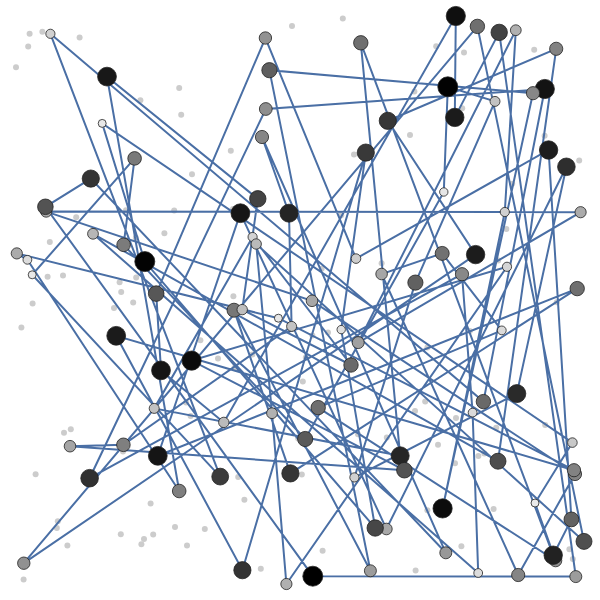
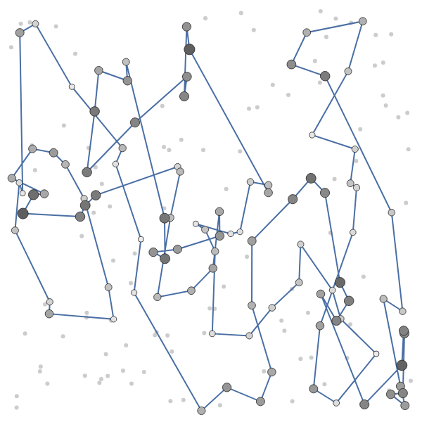
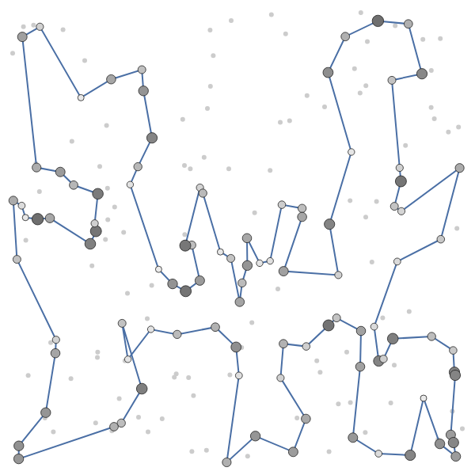
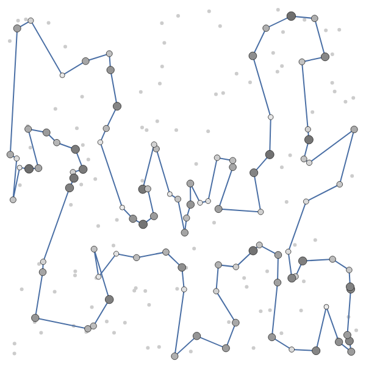
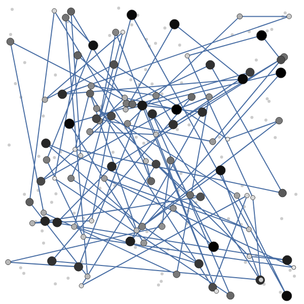
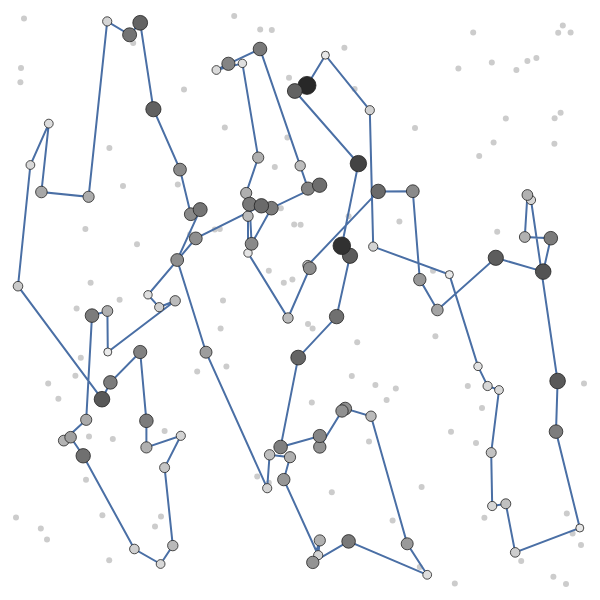
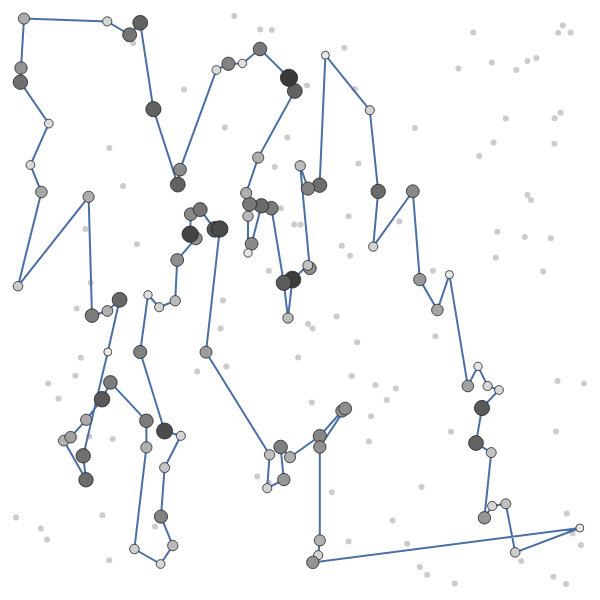
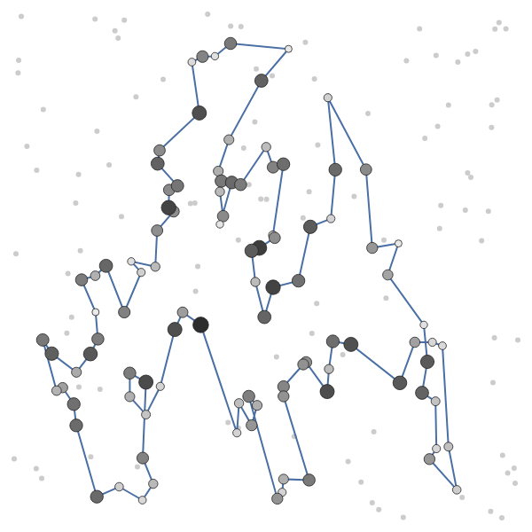

# Lab 1 - Greedy heuristics

Evolutionary Computation, Assignment 1

## 1. Problem

Each instance (TSPA, TSPB) has 200 nodes with coordinates (x, y) and a cost. Select exactly **k = 100** nodes and connect them in a **cycle**. Minimise **objective = cycle length + sum of selected node costs**. Distances are Euclidean, rounded to integers.

## 2. Algorithms

200 solutions per greedy method (one starting from each node) and 200 random solutions. "Nearest" always means the best increase of the objective (distance change + node cost).

```
Random:       tour = first k nodes of a random permutation

NN-end(start):
  tour = [start]
  while |tour| < k:
      u = unvisited node minimising dist(last, u) + cost(u)
      append u

NN-any(start):
  tour = [start]
  while |tour| < k:
      for each unvisited u, each position p (front, between nodes, end):
          delta = added length(u at p) + cost(u)
      insert the (u, p) with smallest delta

Greedy-cycle(start):
  v = unvisited node minimising dist(start, v) + cost(v);  tour = [start, v]
  while |tour| < k:
      for each unvisited u, each cycle edge (a,b):
          delta = d(a,u) + d(u,b) - d(a,b) + cost(u)
      insert the (u, edge) with smallest delta
```

## 3. Results (objective value, 200 runs each)

| Instance | Method | Min | Max | Avg | Checked |
|---|---|--:|--:|--:|---|
| TSPA | Random | 237131 | 287973 | 263514 | yes |
| TSPA | NN (end only) | 84362 | 90075 | 87477 | yes |
| TSPA | NN (any position) | 72328 | 77022 | 74347 | yes |
| TSPA | Greedy cycle | 72590 | 75281 | 73797 | yes |
| TSPB | Random | 188214 | 231879 | 206802 | yes |
| TSPB | NN (end only) | 56007 | 63166 | 59397 | yes |
| TSPB | NN (any position) | 52915 | 66164 | 59475 | yes |
| TSPB | Greedy cycle | 53016 | 63736 | 59709 | yes |

All best solutions were verified with the solver checker. Python, C, C++ and Rust give identical results: yes.

## 4. Best solutions - visualisation

Node colour and size = cost (dark/large = expensive). Grey dots are unselected nodes.

### Instance TSPA

{width=8cm}

{width=8cm}

{width=8cm}

{width=8cm}

### Instance TSPB

{width=8cm}

{width=8cm}

{width=8cm}

{width=8cm}

## 5. Best solutions - node lists (0-based)

### Instance TSPA

**Random** (objective 237131): 128, 34, 55, 103, 152, 57, 106, 85, 120, 112, 86, 43, 48, 96, 63, 38, 100, 61, 164, 195, 178, 194, 58, 117, 6, 158, 173, 40, 37, 121, 156, 192, 5, 101, 165, 1, 29, 131, 147, 60, 52, 170, 64, 54, 142, 93, 41, 88, 107, 159, 80, 68, 20, 36, 15, 22, 12, 146, 67, 116, 149, 189, 137, 133, 35, 99, 51, 30, 13, 154, 122, 75, 155, 33, 115, 162, 23, 87, 197, 56, 19, 78, 118, 82, 66, 182, 139, 190, 144, 161, 127, 65, 191, 50, 114, 45, 16, 26, 163, 129

**NN (end only)** (objective 84362): 54, 9, 33, 36, 177, 67, 144, 53, 135, 58, 134, 176, 174, 106, 89, 107, 57, 182, 151, 93, 50, 3, 1, 164, 178, 29, 136, 186, 184, 47, 159, 130, 153, 78, 88, 193, 170, 146, 75, 64, 150, 42, 113, 43, 85, 142, 8, 131, 84, 158, 192, 181, 114, 141, 180, 132, 76, 80, 48, 31, 63, 149, 168, 97, 127, 187, 30, 123, 152, 108, 60, 116, 49, 11, 119, 160, 83, 90, 51, 16, 35, 87, 45, 140, 52, 179, 185, 28, 102, 156, 157, 71, 91, 38, 100, 4, 112, 139, 115, 5

**NN (any position)** (objective 72328): 104, 129, 69, 127, 97, 168, 116, 149, 63, 11, 49, 160, 83, 123, 100, 152, 108, 60, 31, 48, 80, 91, 157, 71, 4, 76, 132, 180, 28, 102, 185, 35, 156, 51, 16, 67, 144, 140, 53, 179, 52, 177, 36, 33, 9, 54, 131, 174, 8, 164, 186, 136, 163, 29, 101, 178, 1, 169, 3, 50, 147, 47, 93, 106, 42, 89, 113, 130, 159, 146, 170, 153, 193, 78, 88, 107, 64, 57, 182, 151, 150, 176, 72, 134, 84, 58, 158, 192, 181, 114, 135, 73, 45, 87, 141, 187, 30, 189, 2, 171

**Greedy cycle** (objective 72590): 31, 116, 149, 168, 63, 11, 49, 60, 108, 152, 100, 90, 123, 83, 160, 97, 127, 69, 171, 2, 189, 30, 187, 141, 87, 45, 73, 135, 114, 181, 192, 158, 58, 84, 134, 72, 176, 150, 151, 182, 57, 64, 107, 88, 78, 193, 153, 170, 146, 159, 130, 113, 89, 42, 106, 93, 47, 147, 50, 3, 169, 1, 178, 101, 29, 163, 136, 186, 164, 142, 8, 174, 131, 54, 9, 33, 36, 177, 52, 179, 53, 140, 144, 67, 16, 51, 156, 35, 185, 102, 28, 180, 132, 76, 4, 71, 157, 91, 80, 48

### Instance TSPB

**Random** (objective 188214): 80, 23, 16, 71, 163, 97, 140, 42, 136, 144, 107, 193, 172, 44, 12, 15, 105, 190, 160, 98, 151, 116, 103, 45, 147, 195, 177, 60, 110, 64, 153, 55, 73, 106, 188, 137, 17, 170, 50, 8, 13, 6, 88, 104, 0, 133, 38, 184, 61, 4, 113, 5, 68, 20, 111, 134, 129, 39, 191, 59, 148, 54, 63, 158, 96, 21, 198, 171, 95, 142, 1, 181, 27, 186, 34, 51, 161, 18, 75, 46, 130, 154, 56, 77, 176, 162, 139, 199, 57, 90, 2, 91, 185, 19, 168, 40, 132, 84, 66, 30

**NN (end only)** (objective 56007): 32, 89, 57, 76, 54, 127, 129, 90, 153, 20, 14, 2, 110, 118, 56, 114, 196, 10, 148, 143, 78, 192, 162, 104, 185, 184, 3, 151, 69, 172, 133, 120, 96, 121, 198, 48, 72, 46, 86, 117, 160, 136, 8, 21, 154, 140, 47, 170, 125, 177, 6, 132, 29, 197, 175, 134, 45, 60, 40, 71, 155, 97, 115, 180, 65, 28, 149, 145, 158, 116, 147, 42, 50, 130, 30, 183, 38, 64, 85, 59, 167, 51, 87, 179, 82, 88, 171, 99, 67, 24, 34, 181, 152, 73, 98, 27, 135, 75, 79, 156

**NN (any position)** (objective 52915): 110, 2, 14, 20, 74, 153, 182, 52, 90, 129, 127, 80, 54, 192, 162, 104, 76, 185, 57, 89, 86, 46, 72, 3, 184, 173, 151, 122, 117, 8, 160, 69, 172, 136, 133, 120, 156, 43, 48, 96, 198, 121, 130, 191, 50, 42, 147, 116, 37, 146, 13, 149, 28, 145, 65, 158, 177, 125, 26, 170, 197, 36, 132, 29, 6, 180, 115, 155, 71, 175, 134, 45, 157, 60, 40, 141, 97, 154, 140, 47, 38, 21, 176, 30, 183, 189, 168, 64, 59, 85, 51, 73, 167, 152, 34, 24, 181, 179, 87, 82

**Greedy cycle** (objective 53016): 49, 64, 33, 40, 60, 71, 155, 141, 157, 45, 134, 175, 62, 36, 197, 29, 132, 178, 103, 6, 180, 115, 170, 177, 125, 26, 97, 140, 154, 47, 38, 21, 176, 30, 183, 191, 130, 63, 121, 198, 96, 48, 89, 156, 120, 133, 136, 172, 160, 69, 8, 117, 72, 46, 86, 184, 3, 173, 122, 151, 98, 111, 27, 135, 76, 185, 57, 104, 162, 54, 192, 127, 52, 182, 153, 20, 74, 2, 14, 90, 129, 80, 150, 84, 66, 67, 31, 24, 34, 152, 181, 88, 179, 87, 82, 73, 167, 51, 59, 85

## 6. Source code

`labs/lab1/{python,c,cpp,rust}/solver.*`, shared code in `common/`.

## 7. Conclusions

- Random solutions are far worse than any greedy method (about 3-4x the objective).
- On TSPA, inserting at any position (NN-any, greedy cycle) is clearly better than appending at the end (avg ~74000 vs ~87500), because the paths become much shorter.
- On TSPA, NN-any and greedy cycle are close (best 72328 vs 72590; greedy cycle has the slightly better average).
- On TSPB all three greedy methods have similar averages (~59500); NN-any and greedy cycle reach better best values (~53000 vs 56007), so the benefit shows mainly in the best start nodes.
- Greedy methods are deterministic given the start node, so spread comes only from the start choice; trying all starts and keeping the best is cheap and worthwhile.
