# Lab 1 - Greedy heuristics

Author: Michał Żurawski 160252

## Description of the problem

Each instance has n = 200 nodes with coordinates (x, y) and a cost. Select exactly **half of the nodes** (k = 100) and connect them into a **closed cycle** that minimises **cycle length + sum of node costs**. Distances are Euclidean, rounded to integers.

## Algorithms

Three **greedy construction** methods (run i starts from node i). Each step adds the node that **increases the objective the least**; the methods differ only in **where the new node may be inserted**. **Random solutions** are the baseline.

### Intuition

**Problem:** a random tour ignores both distances and node costs, and a plain nearest node can be close but expensive.

**Idea:** grow the tour one node at a time, always adding the node that increases the length plus cost the least: about 3.5 times better than random tours. The variants differ in where a node may go: only after the path end, between any two tour nodes, or into a tour kept closed at every step.

### Core calculations

<!-- columns -->
For every unused node u we calculate **Δ = the increase of the objective** of inserting u at a given place; the **(node, place) with the smallest Δ** is inserted.

**Between tour nodes a and b:**
`Δ = d(a, u) + d(u, b) − d(a, b) + cost(u)`

**In front of the path:** `Δ = d(u, first) + cost(u)`

**After the path** (the only option of end only):
`Δ = d(last, u) + cost(u)`

The path is closed into a cycle at the end.

| Method | Start | u may go |
|---|---|---|
| Random | k random nodes | – |
| NN (end only) | [start] | after the last node |
| NN (any position) | [start] | front, between nodes, end |
| Greedy cycle | [start, best partner] | into any cycle edge |

Best partner = the node minimising `d(start, v) + cost(v)`.
<!-- column -->
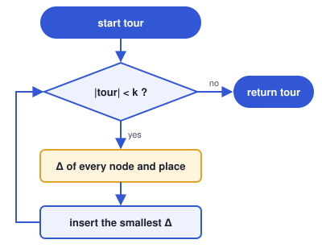
<!-- /columns -->

<!-- pagebreak -->
### Complexity

| Method | Complexity per run | Δ per run |
|---|---|--:|
| Random solution | O(n) | 0 |
| Nearest neighbor (end only) | O(nk) | 14 850 |
| Nearest neighbor (any position) | O(nk²) | 676 500 |
| Greedy cycle | O(nk²) | 661 650 |

Δ per run is the TSPA average over 200 runs.

#### Explanation

A run has k − 1 = 99 steps, each adding one node; t = the number of tour nodes before the step, so n − t nodes are unused.

- **Random solution:** shuffles the n nodes and keeps the first k → **O(n)**, no Δ.
- **Nearest neighbor (end only):** step t computes one Δ per unused node, n − t ≤ n Δ in each of the k steps → **O(nk)** per run; in total `Σ (n − t) = 14 850` for t = 1 … 99.
- **Nearest neighbor (any position):** step t computes a Δ for every unused node at each of the t + 1 places of the path, (n − t)(t + 1) ≤ nk Δ in each of the k steps → **O(nk²)** per run; in total `Σ (n − t)(t + 1) = 676 500` for t = 1 … 99.
- **Greedy cycle:** n − 1 Δ to pick the second node, then step t computes a Δ for every unused node in each of the t cycle edges, (n − t) · t ≤ nk Δ in each of the k steps → **O(nk²)** per run; in total `(n − 1) + Σ (n − t) · t = 661 650` for t = 2 … 99.
- So inserting at any place computes **about 45× more Δ than end only**, because every step tries every place of the tour.

### Pseudocode

Simplified from `python/solver.py`. The three greedy methods share the loop; they differ in the starting tour and in how the next node and its position are found.

```
def greedy(start):
    tour = [start]                                     # greedy cycle: + nearest partner
    while len(tour) < k:
        node, position = cheapest_insertion(tour)      # end only: nearest_unused_node(tour[-1]), at the end
        tour.insert(position, node)
    return tour

def cheapest_insertion(tour):
    for u in unused_nodes:
        length_increase, position = cheapest_position(tour, u)   # in the path or in the cycle
        value = length_increase + cost[u]
    return the u with the smallest value, and its position

def random_solution(seed):
    shuffle(nodes)
    return nodes[:k]
```

## Results

<!-- auto:results (generated: edits between these markers are overwritten) -->
Objective = cycle length + node costs, 200 runs per method. Cells: av (min – max), best of each per instance in bold.
All best solutions were checked with the solution checker: **yes**.
Results are identical in all implemented languages: **yes**.

| Method | TSPA | TSPB |
|---|:-:|:-:|
| Random solution | 263514 (237131 – 287973) | 206802 (188214 – 231879) |
| Nearest neighbor (end only) | 87477 (84362 – 90075) | **59397** (56007 – **63166**) |
| Nearest neighbor (any position) | 74347 (**72328** – 77022) | 59475 (**52915** – 66164) |
| Greedy cycle | **73797** (72590 – **75281**) | 59709 (53016 – 63736) |

### Visualisation (Instance TSPA)

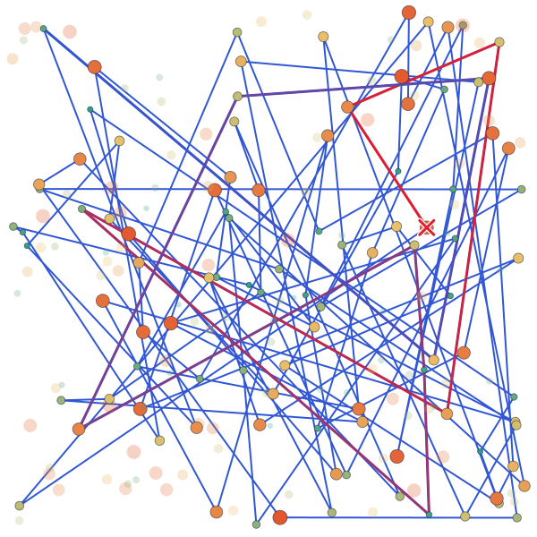
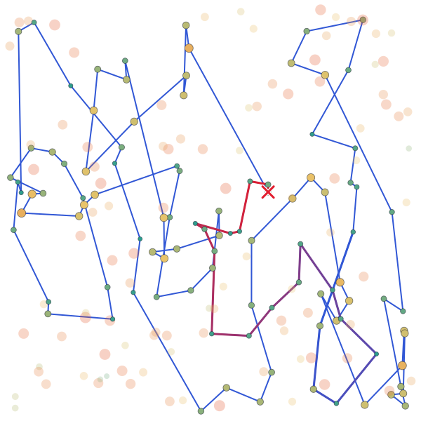
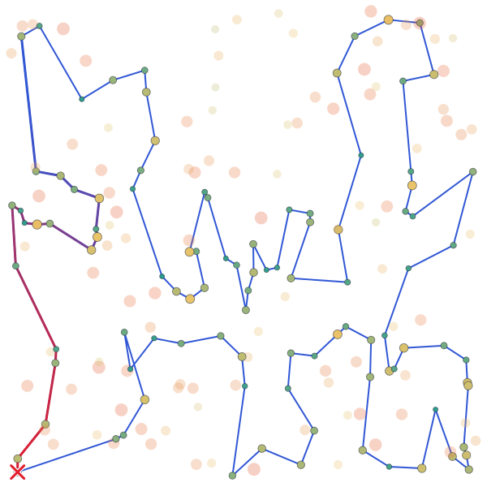
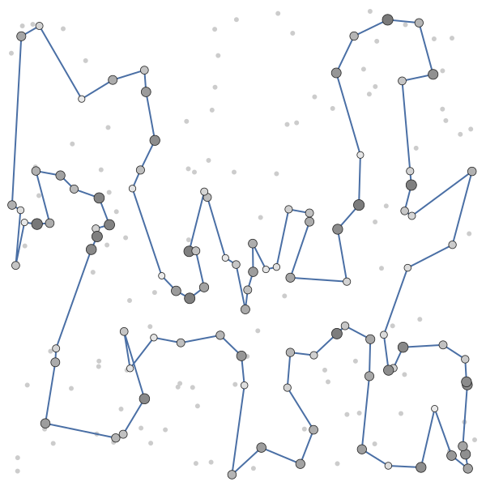

### Visualisation (Instance TSPB)

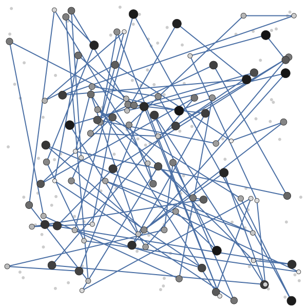
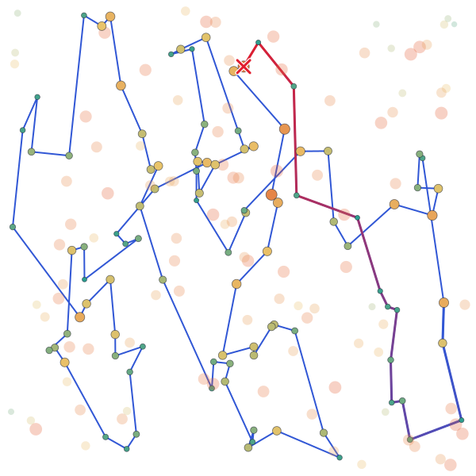
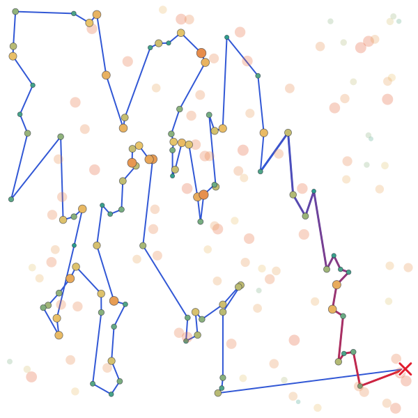
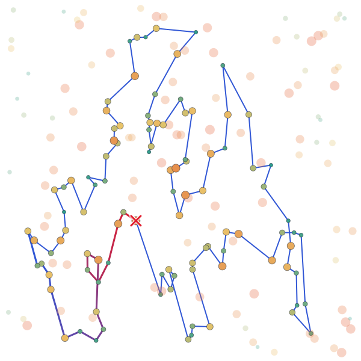
<!-- /auto:results -->

## Running time

<!-- auto:times (generated: edits between these markers are overwritten) -->
Average time of one run **in ms** (algorithm only, same runs as above); the fastest language per row is in bold.

### Instance TSPA

| Method | Python | C | C++ | Rust |
|---|--:|--:|--:|--:|
| Random solution | 0.08 | 0.00 | 0.00 | **0.00** |
| Nearest neighbor (end only) | 0.37 | **0.01** | 0.02 | 0.02 |
| Nearest neighbor (any position) | 24.39 | 0.53 | **0.48** | 0.57 |
| Greedy cycle | 22.58 | 0.69 | **0.46** | 0.65 |

### Pareto plot (Instance TSPA)

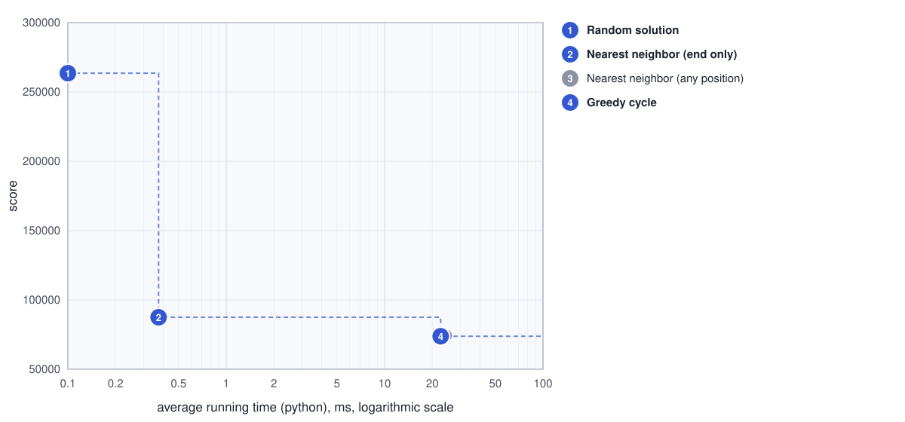

### Instance TSPB

| Method | Python | C | C++ | Rust |
|---|--:|--:|--:|--:|
| Random solution | 0.07 | **0.00** | 0.00 | 0.00 |
| Nearest neighbor (end only) | 0.36 | **0.02** | 0.02 | 0.02 |
| Nearest neighbor (any position) | 23.51 | 0.53 | **0.52** | 0.56 |
| Greedy cycle | 21.92 | 0.54 | **0.46** | 0.64 |

### Pareto plot (Instance TSPB)

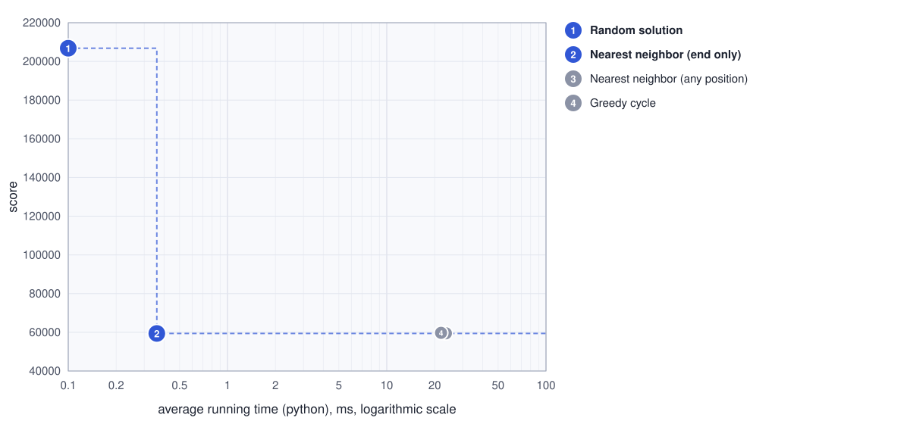
<!-- /auto:times -->

## Best solutions (0-based node indices)

<!-- auto:solutions (generated: edits between these markers are overwritten) -->
### Instance TSPA

**Random solution**
128, 34, 55, 103, 152, 57, 106, 85, 120, 112, 86, 43, 48, 96, 63, 38, 100, 61, 164, 195, 178, 194, 58, 117, 6, 158, 173, 40, 37, 121, 156, 192, 5, 101, 165, 1, 29, 131, 147, 60, 52, 170, 64, 54, 142, 93, 41, 88, 107, 159, 80, 68, 20, 36, 15, 22, 12, 146, 67, 116, 149, 189, 137, 133, 35, 99, 51, 30, 13, 154, 122, 75, 155, 33, 115, 162, 23, 87, 197, 56, 19, 78, 118, 82, 66, 182, 139, 190, 144, 161, 127, 65, 191, 50, 114, 45, 16, 26, 163, 129

**Nearest neighbor (end only)**
54, 9, 33, 36, 177, 67, 144, 53, 135, 58, 134, 176, 174, 106, 89, 107, 57, 182, 151, 93, 50, 3, 1, 164, 178, 29, 136, 186, 184, 47, 159, 130, 153, 78, 88, 193, 170, 146, 75, 64, 150, 42, 113, 43, 85, 142, 8, 131, 84, 158, 192, 181, 114, 141, 180, 132, 76, 80, 48, 31, 63, 149, 168, 97, 127, 187, 30, 123, 152, 108, 60, 116, 49, 11, 119, 160, 83, 90, 51, 16, 35, 87, 45, 140, 52, 179, 185, 28, 102, 156, 157, 71, 91, 38, 100, 4, 112, 139, 115, 5

**Nearest neighbor (any position)**
104, 129, 69, 127, 97, 168, 116, 149, 63, 11, 49, 160, 83, 123, 100, 152, 108, 60, 31, 48, 80, 91, 157, 71, 4, 76, 132, 180, 28, 102, 185, 35, 156, 51, 16, 67, 144, 140, 53, 179, 52, 177, 36, 33, 9, 54, 131, 174, 8, 164, 186, 136, 163, 29, 101, 178, 1, 169, 3, 50, 147, 47, 93, 106, 42, 89, 113, 130, 159, 146, 170, 153, 193, 78, 88, 107, 64, 57, 182, 151, 150, 176, 72, 134, 84, 58, 158, 192, 181, 114, 135, 73, 45, 87, 141, 187, 30, 189, 2, 171

**Greedy cycle**
31, 116, 149, 168, 63, 11, 49, 60, 108, 152, 100, 90, 123, 83, 160, 97, 127, 69, 171, 2, 189, 30, 187, 141, 87, 45, 73, 135, 114, 181, 192, 158, 58, 84, 134, 72, 176, 150, 151, 182, 57, 64, 107, 88, 78, 193, 153, 170, 146, 159, 130, 113, 89, 42, 106, 93, 47, 147, 50, 3, 169, 1, 178, 101, 29, 163, 136, 186, 164, 142, 8, 174, 131, 54, 9, 33, 36, 177, 52, 179, 53, 140, 144, 67, 16, 51, 156, 35, 185, 102, 28, 180, 132, 76, 4, 71, 157, 91, 80, 48

### Instance TSPB

**Random solution**
80, 23, 16, 71, 163, 97, 140, 42, 136, 144, 107, 193, 172, 44, 12, 15, 105, 190, 160, 98, 151, 116, 103, 45, 147, 195, 177, 60, 110, 64, 153, 55, 73, 106, 188, 137, 17, 170, 50, 8, 13, 6, 88, 104, 0, 133, 38, 184, 61, 4, 113, 5, 68, 20, 111, 134, 129, 39, 191, 59, 148, 54, 63, 158, 96, 21, 198, 171, 95, 142, 1, 181, 27, 186, 34, 51, 161, 18, 75, 46, 130, 154, 56, 77, 176, 162, 139, 199, 57, 90, 2, 91, 185, 19, 168, 40, 132, 84, 66, 30

**Nearest neighbor (end only)**
32, 89, 57, 76, 54, 127, 129, 90, 153, 20, 14, 2, 110, 118, 56, 114, 196, 10, 148, 143, 78, 192, 162, 104, 185, 184, 3, 151, 69, 172, 133, 120, 96, 121, 198, 48, 72, 46, 86, 117, 160, 136, 8, 21, 154, 140, 47, 170, 125, 177, 6, 132, 29, 197, 175, 134, 45, 60, 40, 71, 155, 97, 115, 180, 65, 28, 149, 145, 158, 116, 147, 42, 50, 130, 30, 183, 38, 64, 85, 59, 167, 51, 87, 179, 82, 88, 171, 99, 67, 24, 34, 181, 152, 73, 98, 27, 135, 75, 79, 156

**Nearest neighbor (any position)**
110, 2, 14, 20, 74, 153, 182, 52, 90, 129, 127, 80, 54, 192, 162, 104, 76, 185, 57, 89, 86, 46, 72, 3, 184, 173, 151, 122, 117, 8, 160, 69, 172, 136, 133, 120, 156, 43, 48, 96, 198, 121, 130, 191, 50, 42, 147, 116, 37, 146, 13, 149, 28, 145, 65, 158, 177, 125, 26, 170, 197, 36, 132, 29, 6, 180, 115, 155, 71, 175, 134, 45, 157, 60, 40, 141, 97, 154, 140, 47, 38, 21, 176, 30, 183, 189, 168, 64, 59, 85, 51, 73, 167, 152, 34, 24, 181, 179, 87, 82

**Greedy cycle**
49, 64, 33, 40, 60, 71, 155, 141, 157, 45, 134, 175, 62, 36, 197, 29, 132, 178, 103, 6, 180, 115, 170, 177, 125, 26, 97, 140, 154, 47, 38, 21, 176, 30, 183, 191, 130, 63, 121, 198, 96, 48, 89, 156, 120, 133, 136, 172, 160, 69, 8, 117, 72, 46, 86, 184, 3, 173, 122, 151, 98, 111, 27, 135, 76, 185, 57, 104, 162, 54, 192, 127, 52, 182, 153, 20, 74, 2, 14, 90, 129, 80, 150, 84, 66, 67, 31, 24, 34, 152, 181, 88, 179, 87, 82, 73, 167, 51, 59, 85
<!-- /auto:solutions -->

## Source code

<!-- auto:source (generated: edits between these markers are overwritten) -->
[labs/lab1](https://github.com/mi-zuri/ec-labs/tree/main/labs/lab1) ([Python](https://github.com/mi-zuri/ec-labs/blob/main/labs/lab1/python/solver.py), [C](https://github.com/mi-zuri/ec-labs/blob/main/labs/lab1/c/solver.c), [C++](https://github.com/mi-zuri/ec-labs/blob/main/labs/lab1/cpp/solver.cpp), [Rust](https://github.com/mi-zuri/ec-labs/blob/main/labs/lab1/rust/solver.rs))
<!-- /auto:source -->

## Conclusions

- Random solutions are **about 3.5 times worse** than any greedy method.
- **Inserting at any position beats appending at the end** on TSPA; on TSPB all greedy methods are close on average.
- Insertion at any position runs **about 30 times longer** than end only, but still well under 1 ms per run.
