# Lab 2 - Greedy regret heuristics

Author: Michał Żurawski 160252

## Description of the problem

Each instance contains nodes with coordinates (x, y) and a cost. Select exactly half of the nodes (rounded up) and connect them into a closed cycle. Minimise **cycle length + sum of the costs of the selected nodes**. Distances are Euclidean, rounded to the nearest integer.

## Algorithms

_TODO: describe the implemented algorithms and give their pseudocode._

## Results

<!-- auto:results (generated: edits between these markers are overwritten) -->
Objective = cycle length + sum of node costs, over 200 runs per method. The best value in each column is in bold.
All best solutions were checked with the solution checker (the same computation as the lecturer's Solution checker.xlsx): **yes**.
Results are identical in all implemented languages: **yes**.

### Instance TSPA

| Method | Min | Max | Avg | Best solution checked |
|---|--:|--:|--:|:-:|
| Lab 1: Random solution | 237131 | 287973 | 263514 | yes |
| Lab 1: Nearest neighbor (end only) | 84362 | 90075 | 87477 | yes |
| Lab 1: Nearest neighbor (any position) | 72328 | 77022 | 74347 | yes |
| Lab 1: Greedy cycle | 72590 | **75281** | 73797 | yes |
| Lab 2: Nearest neighbor (any position), 2-regret | 111527 | 133181 | 122861 | yes |
| Lab 2: Nearest neighbor (any position), 2-regret + best change | 72419 | 78504 | 75561 | yes |
| Lab 2: Greedy cycle, 2-regret | 112654 | 130924 | 121007 | yes |
| Lab 2: Greedy cycle, 2-regret + best change | **72011** | 75532 | **73350** | yes |

### Instance TSPB

| Method | Min | Max | Avg | Best solution checked |
|---|--:|--:|--:|:-:|
| Lab 1: Random solution | 188214 | 231879 | 206802 | yes |
| Lab 1: Nearest neighbor (end only) | 56007 | 63166 | 59397 | yes |
| Lab 1: Nearest neighbor (any position) | 52915 | 66164 | 59475 | yes |
| Lab 1: Greedy cycle | 53016 | 63736 | 59709 | yes |
| Lab 2: Nearest neighbor (any position), 2-regret | 69032 | 80767 | 74763 | yes |
| Lab 2: Nearest neighbor (any position), 2-regret + best change | **50485** | **61406** | **55698** | yes |
| Lab 2: Greedy cycle, 2-regret | 69455 | 78142 | 73403 | yes |
| Lab 2: Greedy cycle, 2-regret + best change | 52906 | 63326 | 57751 | yes |
<!-- /auto:results -->

## Running time

<!-- auto:times (generated: edits between these markers are overwritten) -->
Average time of one run of the algorithm only, over the same runs as above. The fastest language in each row is in bold.

### Instance TSPA

| Method | Python | C | C++ | Rust |
|---|--:|--:|--:|--:|
| Lab 1: Random solution | 77.6 µs | 380 ns | 321 ns | **295 ns** |
| Lab 1: Nearest neighbor (end only) | 374.0 µs | **14.0 µs** | 20.4 µs | 23.5 µs |
| Lab 1: Nearest neighbor (any position) | 24.39 ms | 534.2 µs | **481.1 µs** | 567.2 µs |
| Lab 1: Greedy cycle | 22.58 ms | 687.4 µs | **462.6 µs** | 648.7 µs |
| Lab 2: Nearest neighbor (any position), 2-regret | 42.75 ms | **688.7 µs** | 2.96 ms | 3.21 ms |
| Lab 2: Nearest neighbor (any position), 2-regret + best change | 44.34 ms | **678.8 µs** | 2.86 ms | 3.14 ms |
| Lab 2: Greedy cycle, 2-regret | 43.19 ms | **942.5 µs** | 2.80 ms | 1.41 ms |
| Lab 2: Greedy cycle, 2-regret + best change | 43.23 ms | **943.2 µs** | 2.78 ms | 1.39 ms |

### Instance TSPB

| Method | Python | C | C++ | Rust |
|---|--:|--:|--:|--:|
| Lab 1: Random solution | 70.2 µs | **425 ns** | 481 ns | 500 ns |
| Lab 1: Nearest neighbor (end only) | 360.0 µs | **15.6 µs** | 24.0 µs | 18.3 µs |
| Lab 1: Nearest neighbor (any position) | 23.51 ms | 529.4 µs | **515.9 µs** | 561.6 µs |
| Lab 1: Greedy cycle | 21.92 ms | 541.8 µs | **464.2 µs** | 639.2 µs |
| Lab 2: Nearest neighbor (any position), 2-regret | 44.36 ms | **679.2 µs** | 2.78 ms | 3.66 ms |
| Lab 2: Nearest neighbor (any position), 2-regret + best change | 43.22 ms | **704.9 µs** | 2.91 ms | 3.14 ms |
| Lab 2: Greedy cycle, 2-regret | 43.15 ms | **941.7 µs** | 2.80 ms | 1.48 ms |
| Lab 2: Greedy cycle, 2-regret + best change | 42.78 ms | **941.3 µs** | 2.76 ms | 1.40 ms |
<!-- /auto:times -->

## Visualisation of the best solutions

<!-- auto:plots (generated: edits between these markers are overwritten) -->
Node colour and size show the node cost (dark and large = expensive). Grey dots are nodes not selected.

### Instance TSPA

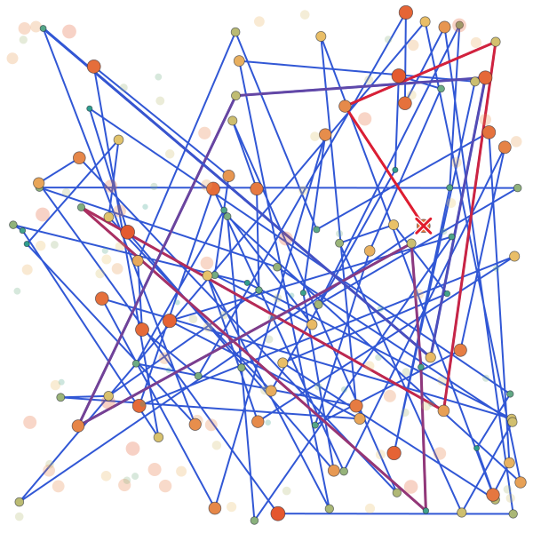
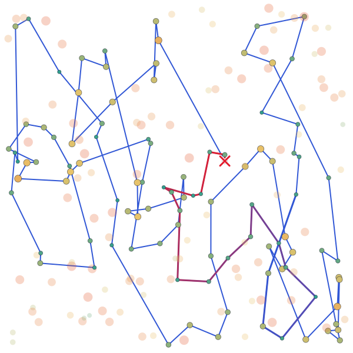
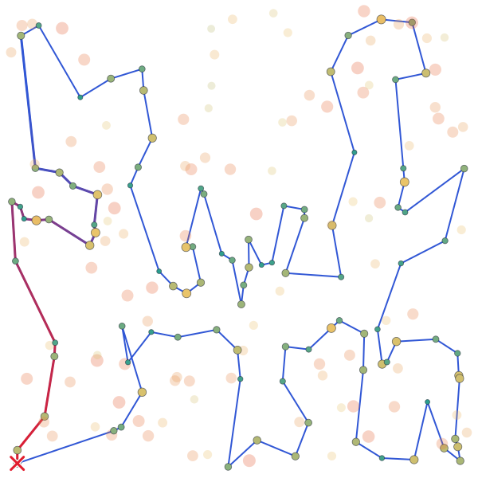

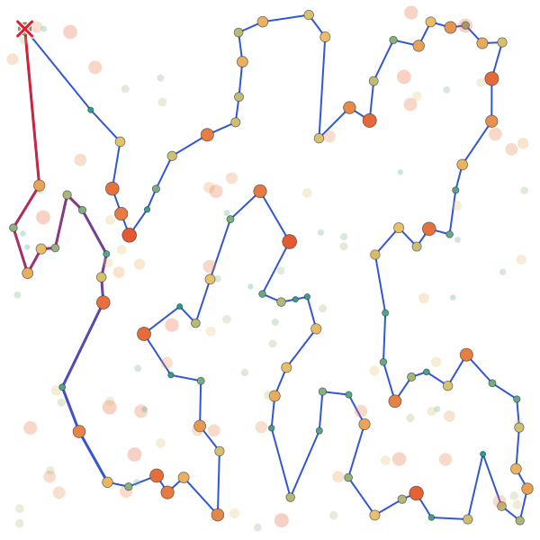
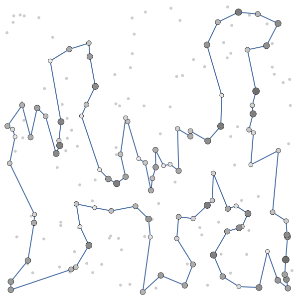
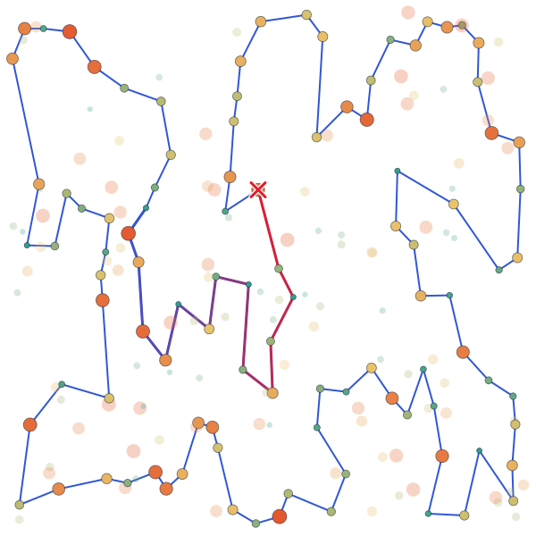
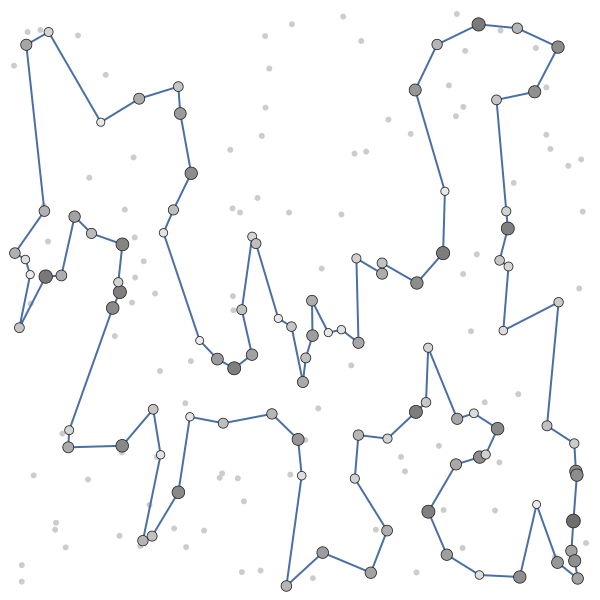

### Instance TSPB

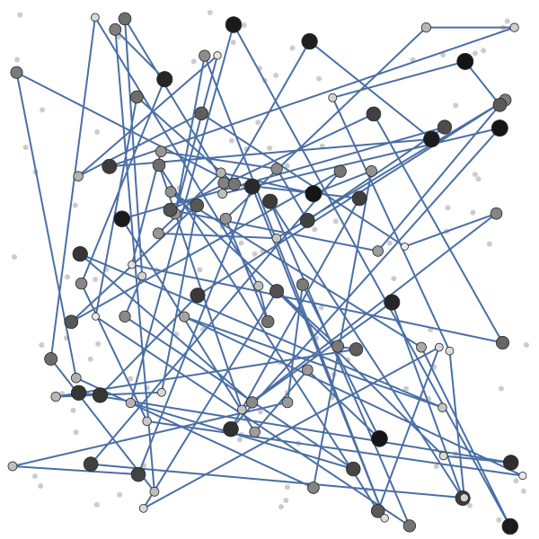
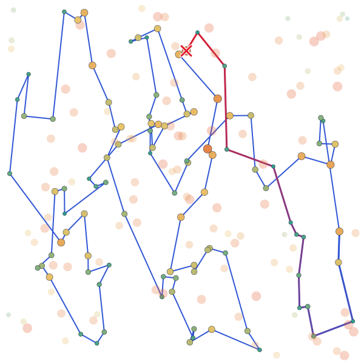
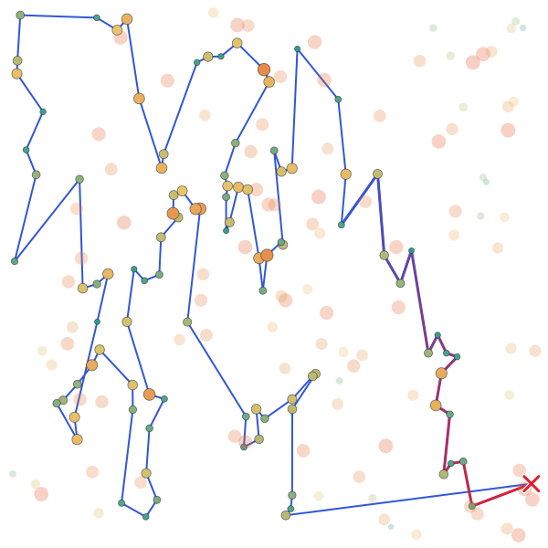
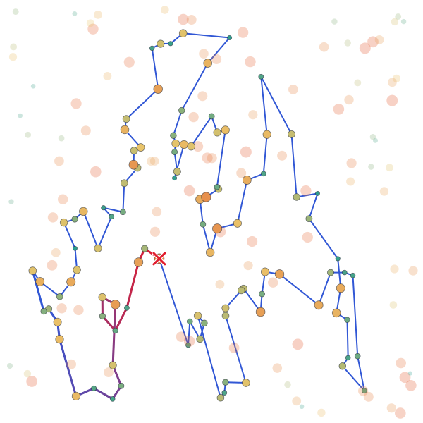
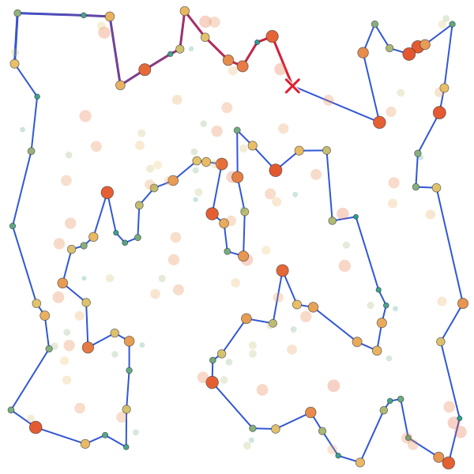
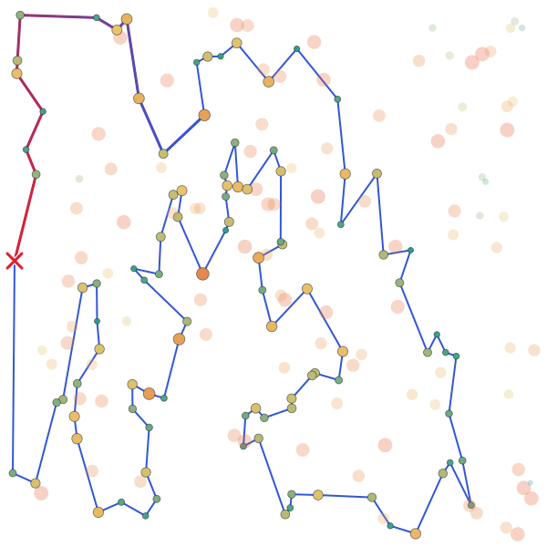
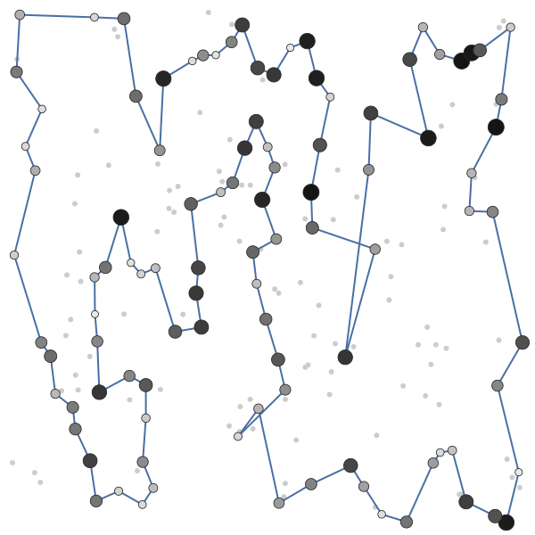
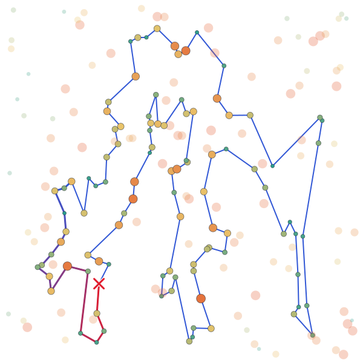
<!-- /auto:plots -->

## Best solutions (0-based node indices)

<!-- auto:solutions (generated: edits between these markers are overwritten) -->
### Instance TSPA

**Lab 1: Random solution** (objective 237131):
128, 34, 55, 103, 152, 57, 106, 85, 120, 112, 86, 43, 48, 96, 63, 38, 100, 61, 164, 195, 178, 194, 58, 117, 6, 158, 173, 40, 37, 121, 156, 192, 5, 101, 165, 1, 29, 131, 147, 60, 52, 170, 64, 54, 142, 93, 41, 88, 107, 159, 80, 68, 20, 36, 15, 22, 12, 146, 67, 116, 149, 189, 137, 133, 35, 99, 51, 30, 13, 154, 122, 75, 155, 33, 115, 162, 23, 87, 197, 56, 19, 78, 118, 82, 66, 182, 139, 190, 144, 161, 127, 65, 191, 50, 114, 45, 16, 26, 163, 129

**Lab 1: Nearest neighbor (end only)** (objective 84362):
54, 9, 33, 36, 177, 67, 144, 53, 135, 58, 134, 176, 174, 106, 89, 107, 57, 182, 151, 93, 50, 3, 1, 164, 178, 29, 136, 186, 184, 47, 159, 130, 153, 78, 88, 193, 170, 146, 75, 64, 150, 42, 113, 43, 85, 142, 8, 131, 84, 158, 192, 181, 114, 141, 180, 132, 76, 80, 48, 31, 63, 149, 168, 97, 127, 187, 30, 123, 152, 108, 60, 116, 49, 11, 119, 160, 83, 90, 51, 16, 35, 87, 45, 140, 52, 179, 185, 28, 102, 156, 157, 71, 91, 38, 100, 4, 112, 139, 115, 5

**Lab 1: Nearest neighbor (any position)** (objective 72328):
104, 129, 69, 127, 97, 168, 116, 149, 63, 11, 49, 160, 83, 123, 100, 152, 108, 60, 31, 48, 80, 91, 157, 71, 4, 76, 132, 180, 28, 102, 185, 35, 156, 51, 16, 67, 144, 140, 53, 179, 52, 177, 36, 33, 9, 54, 131, 174, 8, 164, 186, 136, 163, 29, 101, 178, 1, 169, 3, 50, 147, 47, 93, 106, 42, 89, 113, 130, 159, 146, 170, 153, 193, 78, 88, 107, 64, 57, 182, 151, 150, 176, 72, 134, 84, 58, 158, 192, 181, 114, 135, 73, 45, 87, 141, 187, 30, 189, 2, 171

**Lab 1: Greedy cycle** (objective 72590):
31, 116, 149, 168, 63, 11, 49, 60, 108, 152, 100, 90, 123, 83, 160, 97, 127, 69, 171, 2, 189, 30, 187, 141, 87, 45, 73, 135, 114, 181, 192, 158, 58, 84, 134, 72, 176, 150, 151, 182, 57, 64, 107, 88, 78, 193, 153, 170, 146, 159, 130, 113, 89, 42, 106, 93, 47, 147, 50, 3, 169, 1, 178, 101, 29, 163, 136, 186, 164, 142, 8, 174, 131, 54, 9, 33, 36, 177, 52, 179, 53, 140, 144, 67, 16, 51, 156, 35, 185, 102, 28, 180, 132, 76, 4, 71, 157, 91, 80, 48

**Lab 2: Nearest neighbor (any position), 2-regret** (objective 111527):
199, 82, 116, 119, 11, 49, 108, 152, 123, 160, 12, 97, 120, 92, 171, 166, 183, 10, 22, 98, 27, 87, 141, 23, 180, 28, 156, 16, 190, 74, 144, 179, 177, 36, 99, 41, 61, 135, 181, 58, 84, 134, 65, 158, 111, 182, 105, 57, 64, 107, 88, 78, 26, 75, 170, 159, 130, 117, 113, 106, 150, 0, 176, 174, 8, 142, 85, 128, 3, 1, 59, 46, 86, 55, 17, 29, 19, 163, 24, 136, 186, 109, 34, 62, 154, 39, 175, 115, 5, 112, 139, 18, 4, 76, 132, 68, 44, 14, 38, 80

**Lab 2: Nearest neighbor (any position), 2-regret + best change** (objective 72419):
171, 2, 189, 187, 30, 141, 87, 45, 73, 135, 114, 181, 192, 158, 58, 84, 134, 72, 176, 174, 150, 106, 113, 89, 42, 151, 138, 182, 57, 64, 107, 88, 78, 193, 153, 75, 170, 146, 159, 130, 47, 93, 50, 3, 169, 1, 59, 178, 101, 55, 29, 163, 136, 186, 164, 142, 8, 9, 54, 33, 131, 36, 177, 52, 179, 53, 140, 144, 67, 16, 51, 35, 185, 102, 28, 180, 132, 76, 4, 71, 157, 91, 80, 100, 123, 83, 160, 152, 108, 49, 60, 116, 149, 63, 168, 97, 127, 69, 129, 104

**Lab 2: Greedy cycle, 2-regret** (objective 112654):
190, 52, 177, 140, 61, 45, 67, 35, 102, 180, 145, 23, 162, 68, 132, 76, 4, 71, 91, 137, 126, 48, 199, 77, 82, 63, 49, 108, 152, 100, 123, 160, 12, 161, 97, 188, 129, 110, 92, 171, 166, 183, 10, 27, 70, 98, 25, 114, 118, 181, 192, 158, 58, 84, 134, 72, 0, 151, 106, 89, 124, 57, 64, 107, 193, 75, 170, 159, 130, 117, 93, 81, 85, 142, 164, 169, 47, 37, 147, 21, 155, 101, 17, 29, 19, 163, 24, 136, 186, 109, 34, 62, 154, 39, 175, 5, 112, 139, 133, 51

**Lab 2: Greedy cycle, 2-regret + best change** (objective 72011):
80, 91, 157, 71, 4, 76, 132, 180, 28, 102, 185, 35, 51, 16, 67, 144, 140, 53, 179, 52, 177, 36, 131, 33, 54, 9, 8, 142, 164, 186, 136, 163, 29, 55, 101, 178, 1, 169, 3, 50, 93, 47, 130, 159, 146, 170, 75, 153, 193, 78, 88, 107, 64, 57, 182, 138, 151, 42, 89, 113, 106, 150, 174, 176, 72, 134, 84, 58, 158, 192, 181, 114, 135, 73, 45, 87, 141, 189, 2, 171, 187, 30, 161, 127, 97, 160, 83, 123, 100, 152, 108, 49, 11, 168, 63, 149, 116, 60, 31, 48

### Instance TSPB

**Lab 1: Random solution** (objective 188214):
80, 23, 16, 71, 163, 97, 140, 42, 136, 144, 107, 193, 172, 44, 12, 15, 105, 190, 160, 98, 151, 116, 103, 45, 147, 195, 177, 60, 110, 64, 153, 55, 73, 106, 188, 137, 17, 170, 50, 8, 13, 6, 88, 104, 0, 133, 38, 184, 61, 4, 113, 5, 68, 20, 111, 134, 129, 39, 191, 59, 148, 54, 63, 158, 96, 21, 198, 171, 95, 142, 1, 181, 27, 186, 34, 51, 161, 18, 75, 46, 130, 154, 56, 77, 176, 162, 139, 199, 57, 90, 2, 91, 185, 19, 168, 40, 132, 84, 66, 30

**Lab 1: Nearest neighbor (end only)** (objective 56007):
32, 89, 57, 76, 54, 127, 129, 90, 153, 20, 14, 2, 110, 118, 56, 114, 196, 10, 148, 143, 78, 192, 162, 104, 185, 184, 3, 151, 69, 172, 133, 120, 96, 121, 198, 48, 72, 46, 86, 117, 160, 136, 8, 21, 154, 140, 47, 170, 125, 177, 6, 132, 29, 197, 175, 134, 45, 60, 40, 71, 155, 97, 115, 180, 65, 28, 149, 145, 158, 116, 147, 42, 50, 130, 30, 183, 38, 64, 85, 59, 167, 51, 87, 179, 82, 88, 171, 99, 67, 24, 34, 181, 152, 73, 98, 27, 135, 75, 79, 156

**Lab 1: Nearest neighbor (any position)** (objective 52915):
110, 2, 14, 20, 74, 153, 182, 52, 90, 129, 127, 80, 54, 192, 162, 104, 76, 185, 57, 89, 86, 46, 72, 3, 184, 173, 151, 122, 117, 8, 160, 69, 172, 136, 133, 120, 156, 43, 48, 96, 198, 121, 130, 191, 50, 42, 147, 116, 37, 146, 13, 149, 28, 145, 65, 158, 177, 125, 26, 170, 197, 36, 132, 29, 6, 180, 115, 155, 71, 175, 134, 45, 157, 60, 40, 141, 97, 154, 140, 47, 38, 21, 176, 30, 183, 189, 168, 64, 59, 85, 51, 73, 167, 152, 34, 24, 181, 179, 87, 82

**Lab 1: Greedy cycle** (objective 53016):
49, 64, 33, 40, 60, 71, 155, 141, 157, 45, 134, 175, 62, 36, 197, 29, 132, 178, 103, 6, 180, 115, 170, 177, 125, 26, 97, 140, 154, 47, 38, 21, 176, 30, 183, 191, 130, 63, 121, 198, 96, 48, 89, 156, 120, 133, 136, 172, 160, 69, 8, 117, 72, 46, 86, 184, 3, 173, 122, 151, 98, 111, 27, 135, 76, 185, 57, 104, 162, 54, 192, 127, 52, 182, 153, 20, 74, 2, 14, 90, 129, 80, 150, 84, 66, 67, 31, 24, 34, 152, 181, 88, 179, 87, 82, 73, 167, 51, 59, 85

**Lab 2: Nearest neighbor (any position), 2-regret** (objective 69032):
57, 44, 89, 32, 43, 48, 58, 198, 121, 195, 50, 42, 116, 37, 13, 149, 145, 65, 178, 103, 132, 1, 108, 62, 175, 134, 157, 60, 141, 155, 113, 115, 19, 177, 125, 26, 161, 154, 140, 47, 38, 21, 168, 136, 8, 95, 128, 122, 151, 111, 3, 137, 72, 86, 0, 185, 104, 162, 54, 127, 129, 52, 182, 150, 84, 66, 35, 24, 25, 73, 59, 101, 179, 88, 163, 99, 171, 17, 74, 20, 14, 2, 93, 23, 110, 118, 131, 148, 10, 196, 193, 61, 105, 169, 165, 199, 70, 190, 194, 12

**Lab 2: Nearest neighbor (any position), 2-regret + best change** (objective 50485):
65, 145, 28, 149, 13, 146, 37, 116, 147, 42, 50, 130, 63, 121, 198, 96, 48, 156, 89, 57, 185, 76, 104, 162, 54, 192, 80, 127, 129, 90, 153, 14, 2, 20, 74, 17, 171, 99, 88, 179, 87, 82, 51, 85, 59, 73, 167, 181, 152, 34, 24, 67, 66, 27, 98, 151, 122, 3, 184, 46, 72, 117, 8, 120, 133, 136, 172, 160, 69, 124, 21, 183, 30, 38, 47, 154, 140, 64, 33, 40, 141, 155, 71, 60, 157, 45, 134, 175, 62, 36, 197, 6, 115, 170, 125, 177, 29, 132, 174, 1

**Lab 2: Greedy cycle, 2-regret** (objective 69455):
152, 25, 98, 151, 122, 3, 109, 46, 72, 166, 92, 8, 172, 189, 124, 4, 49, 33, 47, 140, 154, 161, 26, 125, 170, 115, 113, 155, 141, 60, 157, 45, 134, 175, 62, 91, 36, 197, 132, 103, 178, 65, 145, 28, 149, 13, 37, 116, 42, 50, 130, 195, 121, 198, 96, 48, 164, 43, 32, 89, 44, 83, 57, 79, 0, 135, 162, 119, 104, 77, 12, 194, 190, 70, 199, 165, 169, 105, 61, 193, 196, 10, 148, 131, 118, 110, 23, 93, 9, 14, 20, 74, 17, 171, 99, 163, 88, 82, 167, 85

**Lab 2: Greedy cycle, 2-regret + best change** (objective 52906):
60, 157, 45, 134, 175, 71, 113, 36, 197, 132, 29, 6, 180, 115, 170, 177, 125, 26, 97, 154, 140, 47, 38, 21, 30, 183, 191, 130, 63, 121, 198, 96, 48, 43, 156, 32, 89, 57, 79, 185, 104, 54, 196, 114, 10, 90, 14, 2, 74, 20, 153, 129, 127, 80, 192, 162, 76, 135, 27, 11, 66, 67, 24, 34, 152, 181, 126, 88, 179, 87, 82, 167, 51, 85, 59, 73, 98, 151, 122, 173, 3, 184, 86, 46, 72, 117, 8, 120, 133, 136, 172, 160, 69, 124, 4, 64, 33, 155, 141, 40
<!-- /auto:solutions -->

## Source code

<!-- auto:source (generated: edits between these markers are overwritten) -->
Source code of the compared labs:

- Lab 1: [labs/lab1](https://github.com/mi-zuri/ec-labs/tree/main/labs/lab1) ([Python](https://github.com/mi-zuri/ec-labs/blob/main/labs/lab1/python/solver.py), [C](https://github.com/mi-zuri/ec-labs/blob/main/labs/lab1/c/solver.c), [C++](https://github.com/mi-zuri/ec-labs/blob/main/labs/lab1/cpp/solver.cpp), [Rust](https://github.com/mi-zuri/ec-labs/blob/main/labs/lab1/rust/solver.rs))
- Lab 2: [labs/lab2](https://github.com/mi-zuri/ec-labs/tree/main/labs/lab2) ([Python](https://github.com/mi-zuri/ec-labs/blob/main/labs/lab2/python/solver.py), [C](https://github.com/mi-zuri/ec-labs/blob/main/labs/lab2/c/solver.c), [C++](https://github.com/mi-zuri/ec-labs/blob/main/labs/lab2/cpp/solver.cpp), [Rust](https://github.com/mi-zuri/ec-labs/blob/main/labs/lab2/rust/solver.rs))
<!-- /auto:source -->

## Conclusions

_TODO: write the conclusions._
