# Lab 2 - Greedy regret heuristics

Author: Michał Żurawski 160252

## Description of the problem

Each instance has n = 200 nodes with coordinates (x, y) and a cost. Select exactly **half of the nodes** (k = 100) and connect them into a **closed cycle** that minimises **cycle length + sum of node costs**. Distances are Euclidean, rounded to integers.

## Algorithms

Four **greedy construction** methods (run i starts from node i). They grow the solution like lab 1's **nearest neighbor (any position)** and **greedy cycle**, and differ only in **which node is inserted next**.

### Intuition

**Problem:** plain greedy takes the cheapest insertion right now; a node that fits well in only one place loses it once another node takes that place, and later has to go somewhere much worse.

**Idea:** insert first the node that would lose the most by waiting (the highest **regret**); nodes that fit well in several places can wait. Pure regret ignores how cheap an insertion is, so the **best change** variants weigh regret and insertion cost equally.

### Core calculations

<!-- columns -->
For every unused node u we calculate **Δ = the length increase** of inserting it at each place (a, b) (path: also the two ends, cycle: every edge), and from these Δ the **score** that picks the next node.

**Insertion:** `Δ(u, a, b) = d(a, u) + d(u, b) − d(a, b)`

**Regret:** `regret(u) = second smallest Δ − smallest Δ`

**Best change:** `best_change(u) = smallest Δ + cost(u)`

**Score:** `score(u) = α · regret(u) − β · best_change(u)`

The node with the **highest score** is inserted at its smallest-Δ place.

| Method | α | β |
|---|:-:|:-:|
| 2-regret | 1 | 0 |
| 2-regret + best change | 1 | 1 |
<!-- column -->
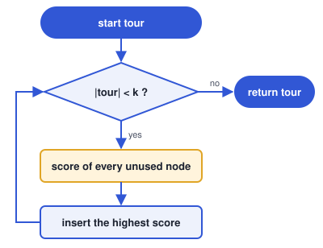
<!-- /columns -->

<!-- pagebreak -->
### Complexity

| Method | Complexity per run | Δ per run |
|---|---|--:|
| Random solution | O(n) | 0 |
| Nearest neighbor (any position) | O(nk²) | 676 500 |
| Greedy cycle | O(nk²) | 661 650 |
| Nearest neighbor (any position), 2-regret | O(nk²) | 676 500 |
| Nearest neighbor (any position), 2-regret + best change | O(nk²) | 676 500 |
| Greedy cycle, 2-regret | O(nk²) | 661 650 |
| Greedy cycle, 2-regret + best change | O(nk²) | 661 650 |

Δ per run is the TSPA average over 200 runs.

#### Explanation

A run has k − 1 = 99 steps, each adding one node; t = the number of tour nodes before the step, so n − t nodes are unused.

- **Random solution:** shuffles the n nodes and keeps the first k → **O(n)**, no Δ.
- **Nearest neighbor (any position)** and its 2-regret variants: step t computes a Δ for every unused node at each of the t + 1 places of the path, (n − t)(t + 1) ≤ nk Δ in each of the k steps → **O(nk²)** per run; in total `Σ (n − t)(t + 1) = 676 500` for t = 1 … 99.
- **Greedy cycle** and its 2-regret variants: n − 1 Δ to pick the second node, then step t computes a Δ for every unused node in each of the t cycle edges, (n − t) · t ≤ nk Δ in each of the k steps → **O(nk²)** per run; in total `(n − 1) + Σ (n − t) · t = 661 650` for t = 2 … 99.
- So **regret computes exactly the same Δ** as plain insertion; it is slower only because it keeps all Δ of a node to find the two smallest, instead of just the smallest.

### Pseudocode

Simplified from `python/solver.py`. Nearest neighbor and greedy cycle share the loop; they differ in the starting tour and in how the insertion increases are listed (`path_insertion_increases` / `cycle_insertion_increases`).

```
def regret_heuristic(start, weights):                # weights = (α, β)
    tour = [start]                                   # greedy cycle: + nearest partner
    while len(tour) < k:
        node, position = regret_insertion(tour, weights)
        tour.insert(position, node)
    return tour

def regret_insertion(tour, weights):
    regret_weight, change_weight = weights
    for u in unused_nodes:
        increases = insertion_increases(tour, u)     # Δ of every position
        position, cheapest, second_cheapest = two_cheapest(increases)
        regret = second_cheapest - cheapest
        best_change = cheapest + cost[u]
        score = regret_weight * regret - change_weight * best_change
    return the u with the highest score, and its position
```

## Results

<!-- auto:results (generated: edits between these markers are overwritten) -->
Objective = cycle length + node costs, 200 runs per method. Cells: av (min – max), best of each per instance in bold.
All best solutions were checked with the solution checker: **yes**.
Results are identical in all implemented languages: **yes**.

| Method | TSPA | TSPB |
|---|:-:|:-:|
| Random solution | 263514 (237131 – 287973) | 206802 (188214 – 231879) |
| Nearest neighbor (end only) | 87477 (84362 – 90075) | 59397 (56007 – 63166) |
| Nearest neighbor (any position) | 74347 (72328 – 77022) | 59475 (52915 – 66164) |
| Greedy cycle | 73797 (72590 – **75281**) | 59709 (53016 – 63736) |
| Nearest neighbor (any position), 2-regret | 122861 (111527 – 133181) | 74763 (69032 – 80767) |
| Nearest neighbor (any position), 2-regret + best change | 75561 (72419 – 78504) | **55698** (**50485** – **61406**) |
| Greedy cycle, 2-regret | 121007 (112654 – 130924) | 73403 (69455 – 78142) |
| Greedy cycle, 2-regret + best change | **73350** (**72011** – 75532) | 57751 (52906 – 63326) |

### Visualisation (Instance TSPA)

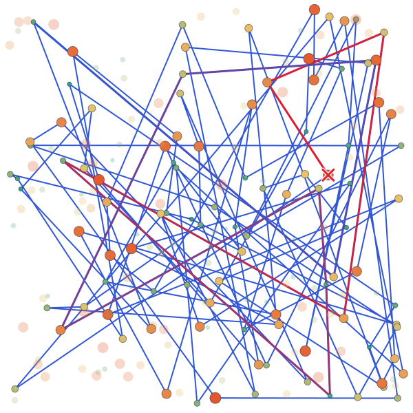
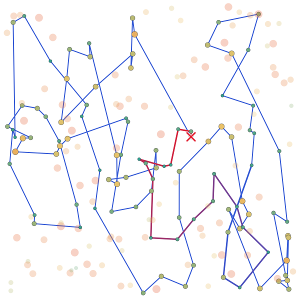
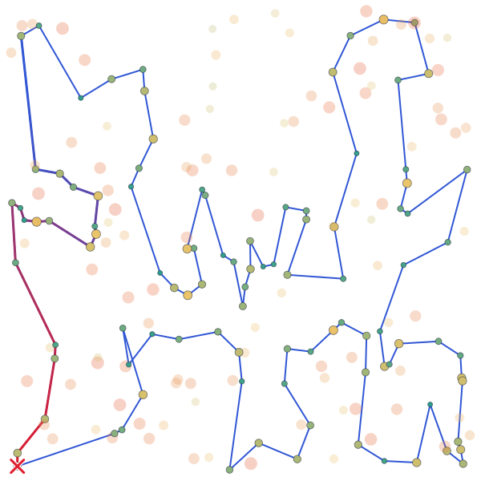
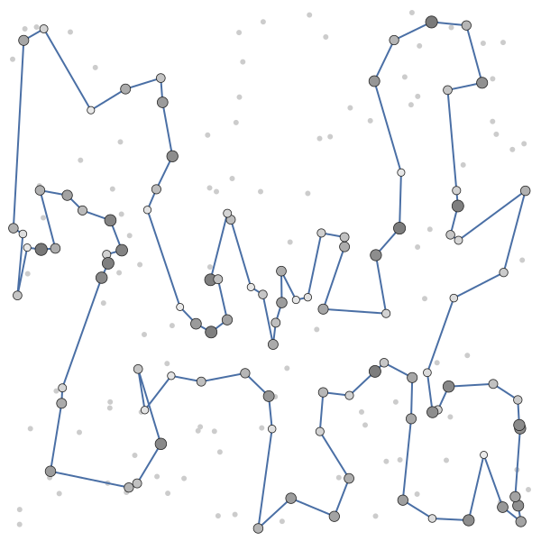
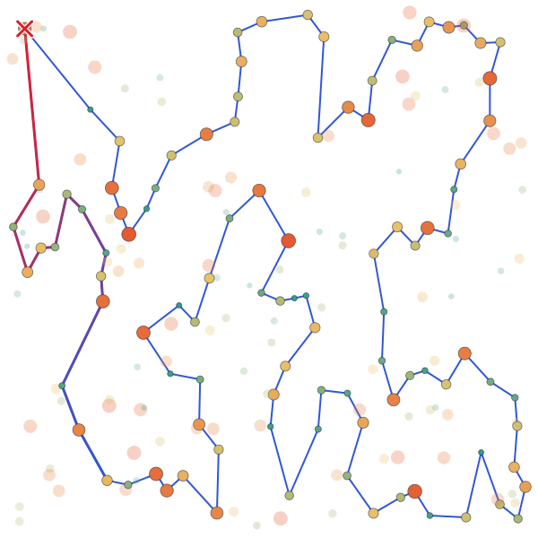
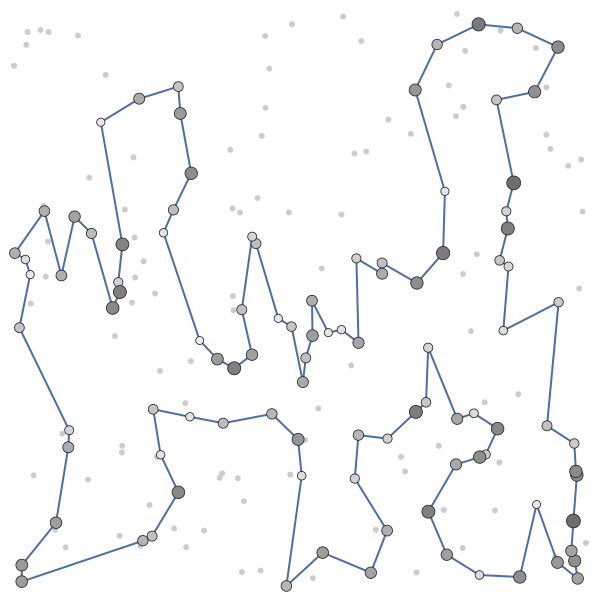
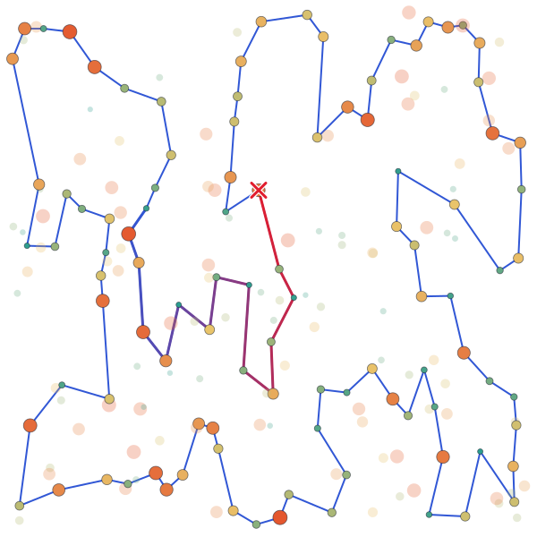
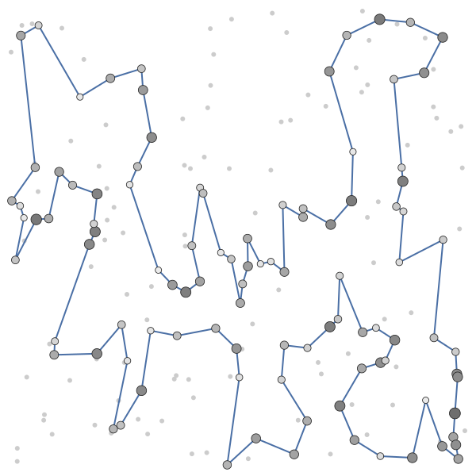

### Visualisation (Instance TSPB)

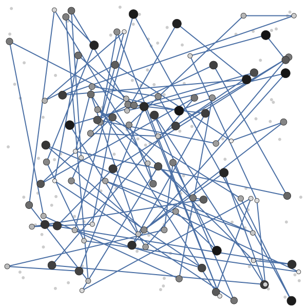
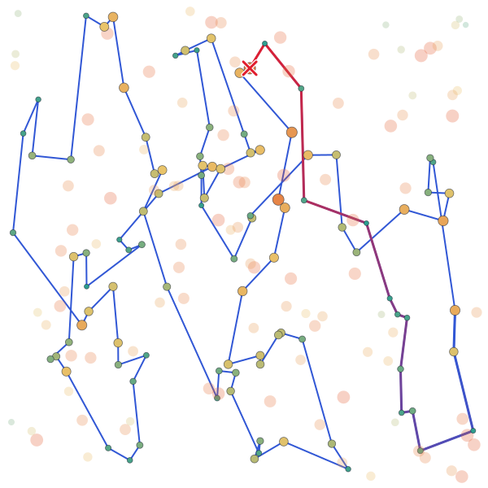
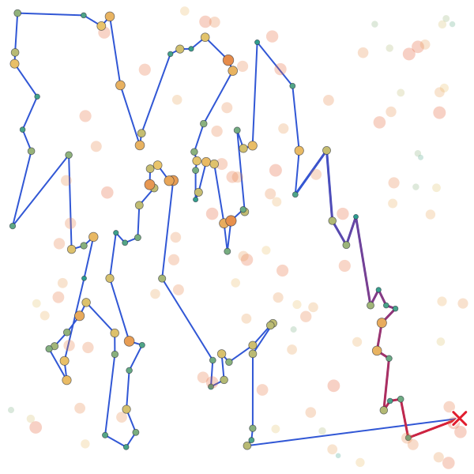
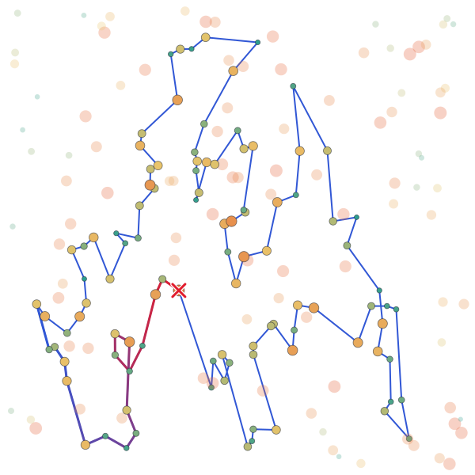
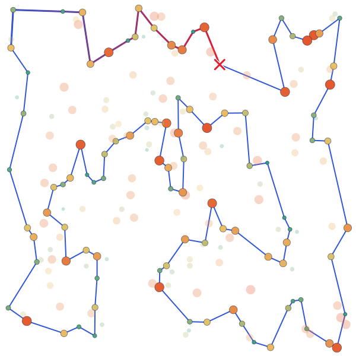
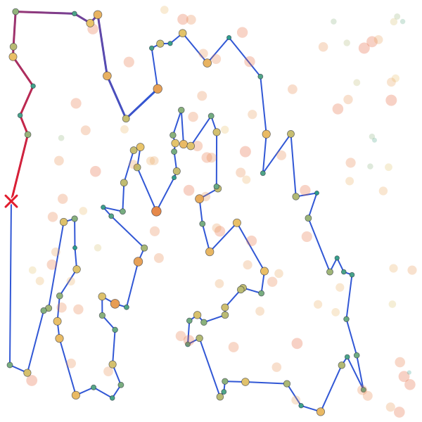
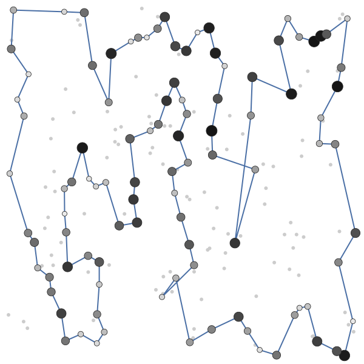
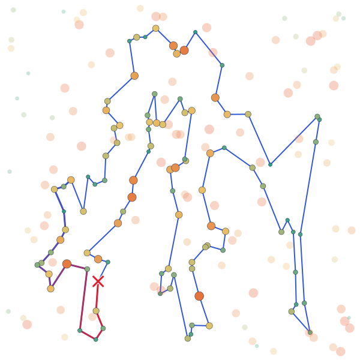
<!-- /auto:results -->

## Running time

<!-- auto:times (generated: edits between these markers are overwritten) -->
Average time of one run **in ms** (algorithm only, same runs as above); the fastest language per row is in bold.

### Instance TSPA

| Method | Python | C | C++ | Rust |
|---|--:|--:|--:|--:|
| Random solution | 0.08 | 0.00 | 0.00 | **0.00** |
| Nearest neighbor (end only) | 0.37 | **0.01** | 0.02 | 0.02 |
| Nearest neighbor (any position) | 24.39 | 0.53 | **0.48** | 0.57 |
| Greedy cycle | 22.58 | 0.69 | **0.46** | 0.65 |
| Nearest neighbor (any position), 2-regret | 42.75 | **0.69** | 2.96 | 3.21 |
| Nearest neighbor (any position), 2-regret + best change | 44.34 | **0.68** | 2.86 | 3.14 |
| Greedy cycle, 2-regret | 43.19 | **0.94** | 2.80 | 1.41 |
| Greedy cycle, 2-regret + best change | 43.23 | **1.00** | 2.78 | 1.39 |

### Pareto plot (Instance TSPA)

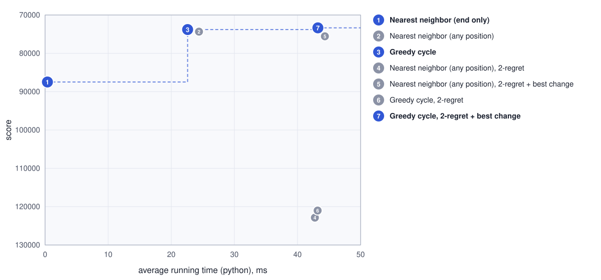

### Instance TSPB

| Method | Python | C | C++ | Rust |
|---|--:|--:|--:|--:|
| Random solution | 0.07 | **0.00** | 0.00 | 0.00 |
| Nearest neighbor (end only) | 0.36 | **0.02** | 0.02 | 0.02 |
| Nearest neighbor (any position) | 23.51 | 0.53 | **0.52** | 0.56 |
| Greedy cycle | 21.92 | 0.54 | **0.46** | 0.64 |
| Nearest neighbor (any position), 2-regret | 44.36 | **0.68** | 2.78 | 3.66 |
| Nearest neighbor (any position), 2-regret + best change | 43.22 | **0.70** | 2.91 | 3.14 |
| Greedy cycle, 2-regret | 43.15 | **0.94** | 2.80 | 1.48 |
| Greedy cycle, 2-regret + best change | 42.78 | **0.94** | 2.76 | 1.40 |

### Pareto plot (Instance TSPB)

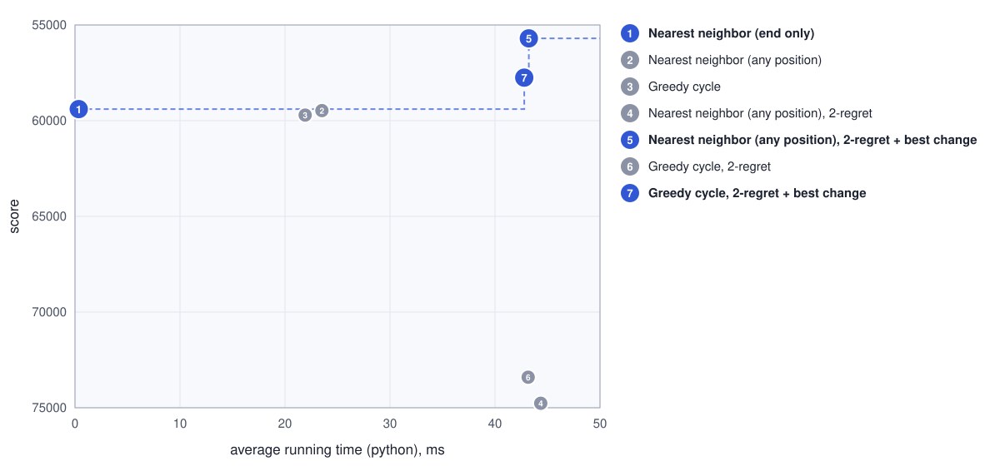
<!-- /auto:times -->

## Best solutions (0-based node indices)

<!-- auto:solutions (generated: edits between these markers are overwritten) -->
### Instance TSPA

**Nearest neighbor (any position), 2-regret**
199, 82, 116, 119, 11, 49, 108, 152, 123, 160, 12, 97, 120, 92, 171, 166, 183, 10, 22, 98, 27, 87, 141, 23, 180, 28, 156, 16, 190, 74, 144, 179, 177, 36, 99, 41, 61, 135, 181, 58, 84, 134, 65, 158, 111, 182, 105, 57, 64, 107, 88, 78, 26, 75, 170, 159, 130, 117, 113, 106, 150, 0, 176, 174, 8, 142, 85, 128, 3, 1, 59, 46, 86, 55, 17, 29, 19, 163, 24, 136, 186, 109, 34, 62, 154, 39, 175, 115, 5, 112, 139, 18, 4, 76, 132, 68, 44, 14, 38, 80

**Nearest neighbor (any position), 2-regret + best change**
171, 2, 189, 187, 30, 141, 87, 45, 73, 135, 114, 181, 192, 158, 58, 84, 134, 72, 176, 174, 150, 106, 113, 89, 42, 151, 138, 182, 57, 64, 107, 88, 78, 193, 153, 75, 170, 146, 159, 130, 47, 93, 50, 3, 169, 1, 59, 178, 101, 55, 29, 163, 136, 186, 164, 142, 8, 9, 54, 33, 131, 36, 177, 52, 179, 53, 140, 144, 67, 16, 51, 35, 185, 102, 28, 180, 132, 76, 4, 71, 157, 91, 80, 100, 123, 83, 160, 152, 108, 49, 60, 116, 149, 63, 168, 97, 127, 69, 129, 104

**Greedy cycle, 2-regret**
190, 52, 177, 140, 61, 45, 67, 35, 102, 180, 145, 23, 162, 68, 132, 76, 4, 71, 91, 137, 126, 48, 199, 77, 82, 63, 49, 108, 152, 100, 123, 160, 12, 161, 97, 188, 129, 110, 92, 171, 166, 183, 10, 27, 70, 98, 25, 114, 118, 181, 192, 158, 58, 84, 134, 72, 0, 151, 106, 89, 124, 57, 64, 107, 193, 75, 170, 159, 130, 117, 93, 81, 85, 142, 164, 169, 47, 37, 147, 21, 155, 101, 17, 29, 19, 163, 24, 136, 186, 109, 34, 62, 154, 39, 175, 5, 112, 139, 133, 51

**Greedy cycle, 2-regret + best change**
80, 91, 157, 71, 4, 76, 132, 180, 28, 102, 185, 35, 51, 16, 67, 144, 140, 53, 179, 52, 177, 36, 131, 33, 54, 9, 8, 142, 164, 186, 136, 163, 29, 55, 101, 178, 1, 169, 3, 50, 93, 47, 130, 159, 146, 170, 75, 153, 193, 78, 88, 107, 64, 57, 182, 138, 151, 42, 89, 113, 106, 150, 174, 176, 72, 134, 84, 58, 158, 192, 181, 114, 135, 73, 45, 87, 141, 189, 2, 171, 187, 30, 161, 127, 97, 160, 83, 123, 100, 152, 108, 49, 11, 168, 63, 149, 116, 60, 31, 48

### Instance TSPB

**Nearest neighbor (any position), 2-regret**
57, 44, 89, 32, 43, 48, 58, 198, 121, 195, 50, 42, 116, 37, 13, 149, 145, 65, 178, 103, 132, 1, 108, 62, 175, 134, 157, 60, 141, 155, 113, 115, 19, 177, 125, 26, 161, 154, 140, 47, 38, 21, 168, 136, 8, 95, 128, 122, 151, 111, 3, 137, 72, 86, 0, 185, 104, 162, 54, 127, 129, 52, 182, 150, 84, 66, 35, 24, 25, 73, 59, 101, 179, 88, 163, 99, 171, 17, 74, 20, 14, 2, 93, 23, 110, 118, 131, 148, 10, 196, 193, 61, 105, 169, 165, 199, 70, 190, 194, 12

**Nearest neighbor (any position), 2-regret + best change**
65, 145, 28, 149, 13, 146, 37, 116, 147, 42, 50, 130, 63, 121, 198, 96, 48, 156, 89, 57, 185, 76, 104, 162, 54, 192, 80, 127, 129, 90, 153, 14, 2, 20, 74, 17, 171, 99, 88, 179, 87, 82, 51, 85, 59, 73, 167, 181, 152, 34, 24, 67, 66, 27, 98, 151, 122, 3, 184, 46, 72, 117, 8, 120, 133, 136, 172, 160, 69, 124, 21, 183, 30, 38, 47, 154, 140, 64, 33, 40, 141, 155, 71, 60, 157, 45, 134, 175, 62, 36, 197, 6, 115, 170, 125, 177, 29, 132, 174, 1

**Greedy cycle, 2-regret**
152, 25, 98, 151, 122, 3, 109, 46, 72, 166, 92, 8, 172, 189, 124, 4, 49, 33, 47, 140, 154, 161, 26, 125, 170, 115, 113, 155, 141, 60, 157, 45, 134, 175, 62, 91, 36, 197, 132, 103, 178, 65, 145, 28, 149, 13, 37, 116, 42, 50, 130, 195, 121, 198, 96, 48, 164, 43, 32, 89, 44, 83, 57, 79, 0, 135, 162, 119, 104, 77, 12, 194, 190, 70, 199, 165, 169, 105, 61, 193, 196, 10, 148, 131, 118, 110, 23, 93, 9, 14, 20, 74, 17, 171, 99, 163, 88, 82, 167, 85

**Greedy cycle, 2-regret + best change**
60, 157, 45, 134, 175, 71, 113, 36, 197, 132, 29, 6, 180, 115, 170, 177, 125, 26, 97, 154, 140, 47, 38, 21, 30, 183, 191, 130, 63, 121, 198, 96, 48, 43, 156, 32, 89, 57, 79, 185, 104, 54, 196, 114, 10, 90, 14, 2, 74, 20, 153, 129, 127, 80, 192, 162, 76, 135, 27, 11, 66, 67, 24, 34, 152, 181, 126, 88, 179, 87, 82, 167, 51, 85, 59, 73, 98, 151, 122, 173, 3, 184, 86, 46, 72, 117, 8, 120, 133, 136, 172, 160, 69, 124, 4, 64, 33, 155, 141, 40
<!-- /auto:solutions -->

## Source code

<!-- auto:source (generated: edits between these markers are overwritten) -->
[labs/lab2](https://github.com/mi-zuri/ec-labs/tree/main/labs/lab2) ([Python](https://github.com/mi-zuri/ec-labs/blob/main/labs/lab2/python/solver.py), [C](https://github.com/mi-zuri/ec-labs/blob/main/labs/lab2/c/solver.c), [C++](https://github.com/mi-zuri/ec-labs/blob/main/labs/lab2/cpp/solver.cpp), [Rust](https://github.com/mi-zuri/ec-labs/blob/main/labs/lab2/rust/solver.rs))
<!-- /auto:source -->

## Conclusions

- Pure 2-regret is even worse than lab 1 solutions because it **ignores node costs**; adding the **best change** fixes this.
- **2-regret + best change beats the lab 1 methods**.
- 2-regret solutions **run much longer** than lab 1 solutions.
