# Lab 3 - Local search

Author: Michał Żurawski 160252

## Description of the problem

Each instance contains nodes with coordinates (x, y) and a cost. Select exactly half of the nodes (rounded up) and connect them into a closed cycle. Minimise **cycle length + sum of the costs of the selected nodes**. Distances are Euclidean, rounded to the nearest integer.

## Algorithms

Eight local search methods, 200 runs each: steepest or greedy × nodes or edges exchange inside the tour × random start (run i uses seed 42 + i) or greedy start (lab 2's best heuristic, greedy cycle with 2-regret + best change, run i starts from node i). Instead of building a tour, they take a complete one and keep improving it with small moves. The greedy start uses the heuristic with the best TSPA average in lab 2 (73 350); on TSPB the nearest neighbor variant with 2-regret + best change was better (55 698 vs 57 751), so the TSPB greedy starts are not the best available ones.

### Intuition

A construction heuristic never takes a decision back: edges may end up crossing, or a cheap unused node could replace an expensive one. Local search takes a complete tour, applies a small change that lowers the objective, and repeats until no change helps (a local optimum). Example: tour A → C → B → D on a 10 × 10 square has two crossing diagonals (length 48); replacing edges (A, C), (B, D) with (A, B), (C, D) gives Δ = 10 + 10 − 14 − 14 = −8, a tour of 40 that construction would never revisit. **Steepest** applies the best move of the whole neighborhood, **greedy** the first improving one found in random order (more steps, each much cheaper).

### Core calculations

<!-- columns -->
Δ = change of the objective, from the changed edges and costs only; p(x), s(x) = predecessor, successor of x.

Inter-route, selected u ↔ unselected v:

`Δ = c(v) − c(u) + d(p,v) + d(v,s) − d(p,u) − d(u,s)`

Nodes exchange a ↔ b (for neighbours only the 2 outer edges change):

`Δ = d(pa,b) + d(b,sa) + d(pb,a) + d(a,sb)`
`  − d(pa,a) − d(a,sa) − d(pb,b) − d(b,sb)`

Edges exchange (a,b), (c,d) → (a,c), (b,d), path b … c reversed:

`Δ = d(a,c) + d(b,d) − d(a,b) − d(c,d)`

A move is applied only if Δ < 0; 14 950 moves per step (n = 200, k = 100).

| Method | picks | intra-route |
|---|---|---|
| Steepest | min Δ of all | nodes / edges |
| Greedy | first Δ < 0 | nodes / edges |
<!-- column -->
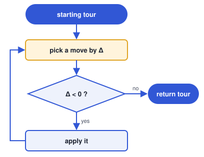
<!-- /columns -->

<!-- pagebreak -->
### Pseudocode

Simplified from `python/solver.py`. All eight methods run `local_search`; they differ in the starting tour (`random_start` / `greedy_start`), in `intra_kind` (`SWAP_NODES` / `SWAP_EDGES`) and in the function that picks the move.

```
def local_search(tour, unselected, search, intra_kind):
    moves = all_moves(k, n - k, intra_kind)    # inter-route + intra-route moves
    while True:
        if search == STEEPEST:
            move = find_best_move(tour, unselected, moves)
        else:
            move = find_first_improving_move(tour, unselected, moves, rng)
        if move is None:
            return tour                         # local optimum
        apply_move(tour, unselected, move)

def find_best_move(tour, unselected, moves):
    best_move, best_delta = None, 0
    for move in moves:
        delta = move_delta(tour, unselected, move)
        if delta < best_delta:
            best_move, best_delta = move, delta
    return best_move

def find_first_improving_move(tour, unselected, moves, rng):
    for tried in range(len(moves)):
        pick = tried + rng.below(len(moves) - tried)
        moves[tried], moves[pick] = moves[pick], moves[tried]
        if move_delta(tour, unselected, moves[tried]) < 0:
            return moves[tried]
    return None

def apply_move(tour, unselected, move):
    kind, i, j = move
    if kind == EXCHANGE_SELECTED: swap tour[i] and unselected[j]
    if kind == SWAP_NODES:        swap tour[i] and tour[j]
    if kind == SWAP_EDGES:        reverse tour[i+1 .. j]
```

**Randomization of the greedy version.** A move is a triple (kind, i, j) of positions, and all moves of both kinds are kept in a single list. Each step browses that list with a lazy Fisher-Yates shuffle: the next move is drawn uniformly from the moves not yet tried in this step, and only that move is evaluated. So every order of the whole neighborhood is equally likely, inter- and intra-route moves are fully mixed, and the step stops at the first improving move, so Δ is never computed for the moves it has not reached.

## Results

<!-- auto:results (generated: edits between these markers are overwritten) -->
Objective = cycle length + sum of node costs, over 200 runs per method. Each cell is av (min – max); the best value of each kind per instance is in bold.
All best solutions were checked with the solution checker (the same computation as the lecturer's Solution checker.xlsx): **yes**.
Results are identical in all implemented languages: **yes**.

| Method | TSPA | TSPB |
|---|:-:|:-:|
| Steepest LS, nodes exchange, random start | 89742 (81937 – 96386) | 66055 (59059 – 74933) |
| Steepest LS, edges exchange, random start | 76225 (74248 – 79388) | **52461** (50265 – **55173**) |
| Greedy LS, nodes exchange, random start | 87889 (81686 – 95320) | 63656 (56270 – 70172) |
| Greedy LS, edges exchange, random start | 76265 (73545 – 78428) | 52913 (**49955** – 55677) |
| Steepest LS, nodes exchange, greedy start | 73018 (**71955** – **74682**) | 57376 (52778 – 63043) |
| Steepest LS, edges exchange, greedy start | 72997 (**71955** – **74682**) | 57019 (52566 – 62301) |
| Greedy LS, nodes exchange, greedy start | 73015 (**71955** – **74682**) | 57379 (52672 – 63043) |
| Greedy LS, edges exchange, greedy start | **72971** (**71955** – **74682**) | 57067 (52672 – 62500) |

### Visualisation (Instance TSPA)

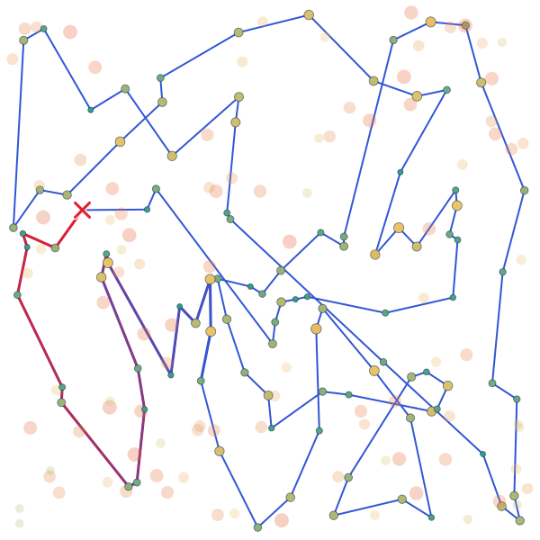
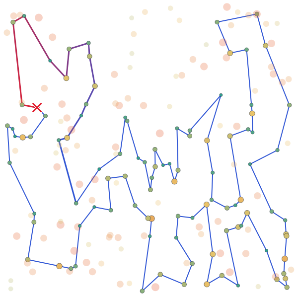
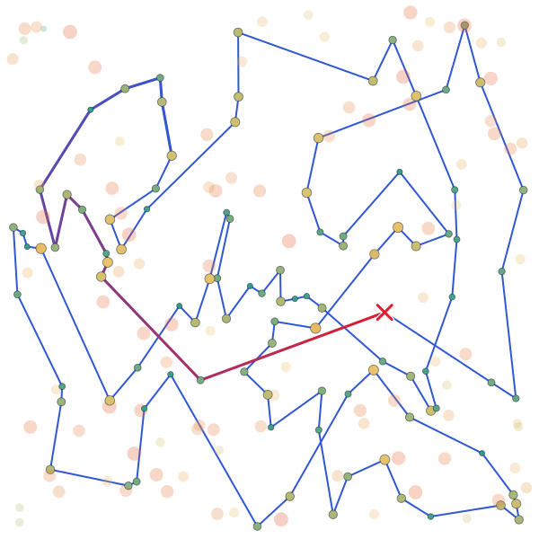
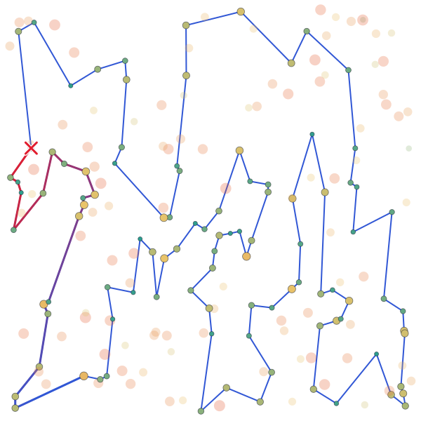
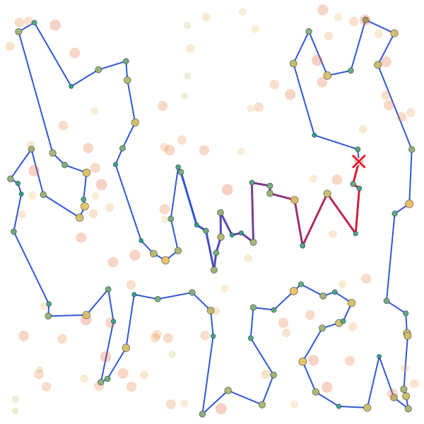


### Visualisation (Instance TSPB)

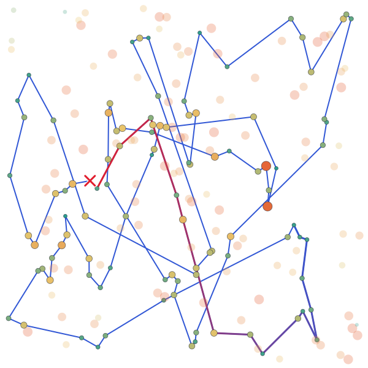
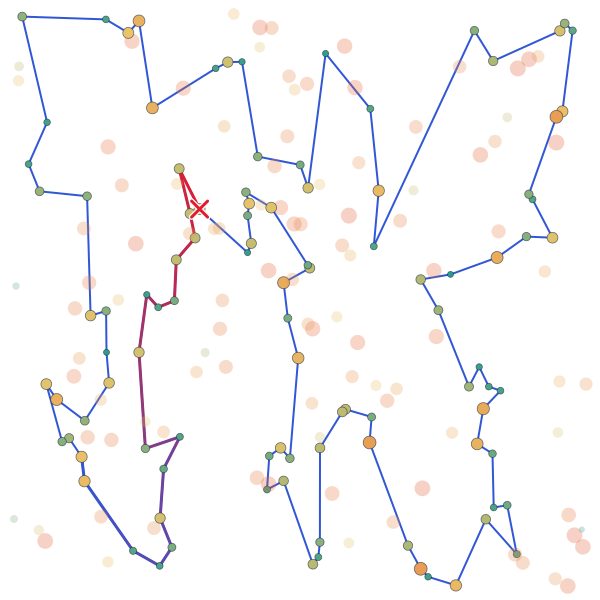
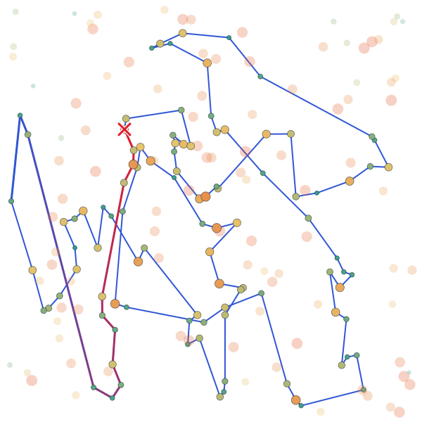
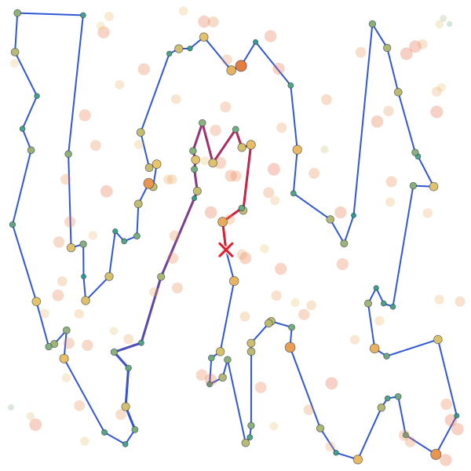
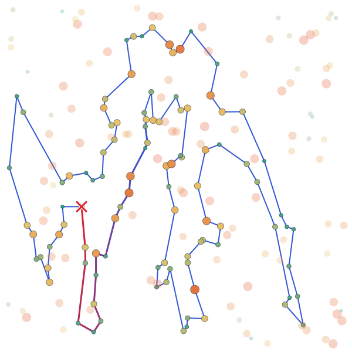
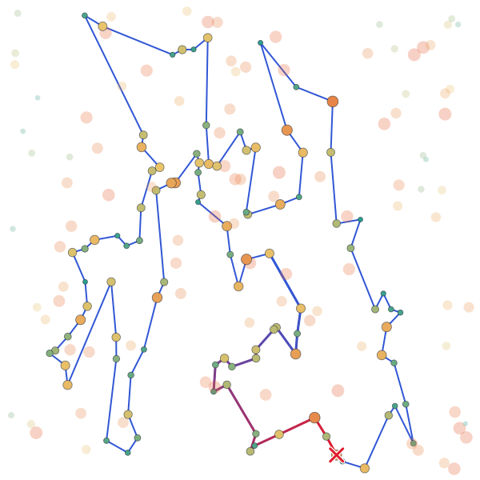
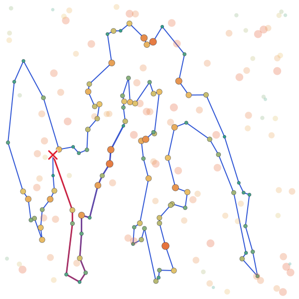

<!-- /auto:results -->

## Running time

<!-- auto:times (generated: edits between these markers are overwritten) -->
Average time of one run of the algorithm only, over the same runs as above. The fastest language in each row is in bold.

### Instance TSPA

| Method | Python | C | C++ | Rust |
|---|--:|--:|--:|--:|
| Steepest LS, nodes exchange, random start | 336.9 ms | 4.69 ms | **4.31 ms** | 6.62 ms |
| Steepest LS, edges exchange, random start | 255.2 ms | 3.48 ms | **3.38 ms** | 4.13 ms |
| Greedy LS, nodes exchange, random start | 70.59 ms | 1.29 ms | **1.26 ms** | 1.37 ms |
| Greedy LS, edges exchange, random start | 44.41 ms | 0.8554 ms | **0.8143 ms** | 0.8704 ms |
| Steepest LS, nodes exchange, greedy start | 45.03 ms | 0.9084 ms | **0.8863 ms** | 0.9632 ms |
| Steepest LS, edges exchange, greedy start | 43.54 ms | 0.8906 ms | **0.8749 ms** | 0.9478 ms |
| Greedy LS, nodes exchange, greedy start | 52.27 ms | 1.08 ms | **1.05 ms** | 1.13 ms |
| Greedy LS, edges exchange, greedy start | 50.53 ms | 1.06 ms | **1.04 ms** | 1.11 ms |

### Pareto plot (Instance TSPA)

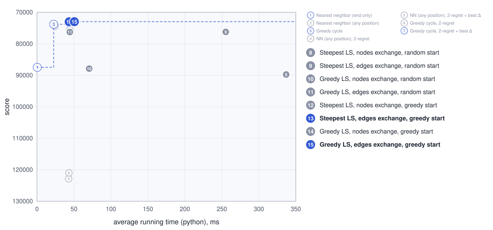

### Instance TSPB

| Method | Python | C | C++ | Rust |
|---|--:|--:|--:|--:|
| Steepest LS, nodes exchange, random start | 329.3 ms | 4.57 ms | **4.37 ms** | 5.46 ms |
| Steepest LS, edges exchange, random start | 294.9 ms | 3.54 ms | **3.44 ms** | 4.28 ms |
| Greedy LS, nodes exchange, random start | 74.65 ms | 1.34 ms | **1.27 ms** | 1.29 ms |
| Greedy LS, edges exchange, random start | 48.77 ms | **0.8300 ms** | 0.8732 ms | 0.9377 ms |
| Steepest LS, nodes exchange, greedy start | 52.11 ms | 1.05 ms | **1.00 ms** | 1.10 ms |
| Steepest LS, edges exchange, greedy start | 59.17 ms | 1.12 ms | **1.04 ms** | 1.16 ms |
| Greedy LS, nodes exchange, greedy start | 57.89 ms | 1.17 ms | **1.12 ms** | 1.23 ms |
| Greedy LS, edges exchange, greedy start | 59.31 ms | 1.21 ms | **1.18 ms** | 1.26 ms |

### Pareto plot (Instance TSPB)

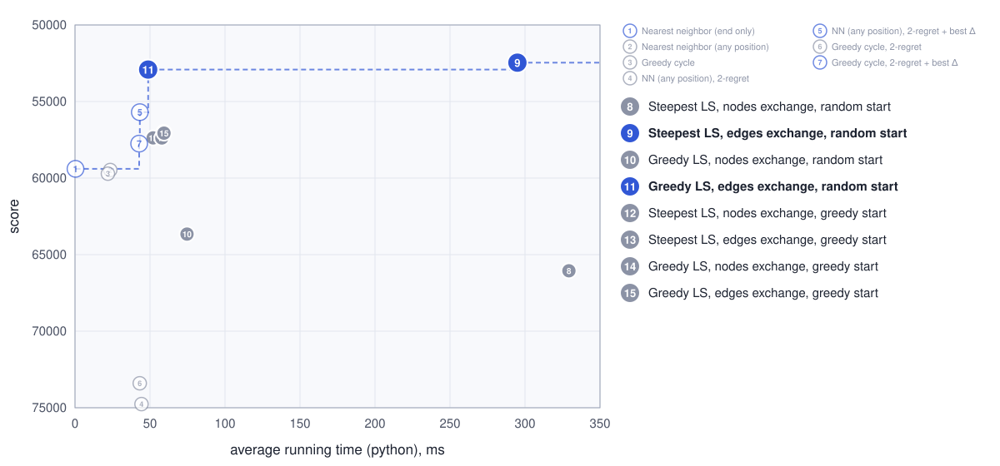
<!-- /auto:times -->

## Best solutions (0-based node indices)

<!-- auto:solutions (generated: edits between these markers are overwritten) -->
### Instance TSPA

**Steepest LS, nodes exchange, random start**
152, 49, 149, 63, 168, 97, 127, 171, 2, 187, 30, 160, 123, 83, 141, 180, 28, 156, 102, 87, 98, 114, 181, 58, 99, 131, 72, 151, 57, 182, 192, 158, 150, 106, 113, 89, 42, 134, 84, 135, 73, 45, 185, 35, 67, 144, 52, 33, 54, 9, 136, 163, 29, 101, 147, 47, 130, 159, 153, 78, 88, 107, 176, 16, 51, 139, 112, 4, 91, 80, 48, 31, 116, 60, 108, 38, 71, 157, 115, 39, 186, 184, 178, 164, 8, 142, 85, 1, 169, 3, 50, 93, 174, 36, 177, 179, 53, 140, 76, 132

**Steepest LS, edges exchange, random start**
108, 60, 31, 48, 80, 38, 91, 157, 71, 4, 76, 132, 90, 123, 30, 180, 35, 51, 16, 67, 144, 140, 53, 179, 52, 177, 36, 99, 131, 33, 54, 9, 164, 8, 174, 176, 150, 106, 43, 85, 3, 50, 169, 1, 178, 184, 136, 29, 101, 147, 47, 93, 130, 159, 146, 170, 75, 153, 193, 78, 88, 107, 113, 89, 42, 151, 57, 182, 111, 138, 72, 134, 84, 58, 158, 192, 181, 114, 135, 61, 73, 45, 185, 28, 87, 141, 187, 2, 171, 92, 69, 127, 97, 168, 116, 149, 63, 11, 49, 152

**Greedy LS, nodes exchange, random start**
174, 87, 160, 83, 123, 152, 108, 49, 60, 80, 91, 157, 71, 4, 76, 100, 90, 132, 139, 112, 115, 186, 136, 184, 1, 50, 93, 106, 89, 42, 150, 176, 131, 36, 177, 179, 52, 144, 67, 185, 35, 16, 51, 156, 28, 180, 30, 161, 11, 63, 149, 116, 168, 97, 127, 69, 171, 2, 187, 141, 114, 181, 134, 72, 151, 107, 153, 193, 78, 88, 57, 182, 138, 158, 192, 58, 84, 135, 73, 45, 140, 53, 99, 8, 142, 85, 3, 164, 9, 54, 33, 143, 62, 178, 29, 101, 147, 47, 159, 130

**Greedy LS, edges exchange, random start**
60, 116, 149, 63, 168, 49, 108, 152, 100, 90, 123, 83, 160, 97, 95, 127, 69, 129, 104, 92, 171, 2, 187, 30, 141, 180, 28, 87, 102, 185, 67, 144, 52, 143, 33, 9, 54, 131, 99, 36, 177, 179, 53, 140, 45, 73, 135, 114, 181, 192, 158, 58, 84, 134, 72, 176, 174, 8, 164, 85, 150, 106, 113, 89, 42, 151, 182, 57, 107, 88, 78, 193, 153, 170, 146, 159, 130, 47, 93, 50, 3, 1, 178, 136, 186, 39, 115, 112, 51, 16, 35, 156, 132, 76, 71, 157, 91, 80, 48, 31

**Steepest LS, nodes exchange, greedy start**
169, 3, 50, 93, 85, 174, 8, 54, 9, 33, 131, 36, 177, 52, 179, 53, 140, 144, 67, 16, 51, 35, 185, 102, 28, 180, 132, 76, 4, 71, 157, 91, 80, 48, 31, 108, 152, 100, 123, 83, 160, 49, 60, 116, 149, 63, 168, 97, 127, 161, 30, 187, 171, 2, 189, 141, 87, 45, 73, 135, 114, 181, 192, 158, 58, 84, 134, 72, 176, 150, 106, 113, 89, 42, 151, 138, 182, 57, 64, 107, 88, 78, 193, 153, 170, 146, 159, 130, 47, 37, 147, 101, 55, 29, 178, 184, 136, 186, 164, 1

**Steepest LS, edges exchange, greedy start**
169, 3, 50, 93, 85, 174, 8, 54, 9, 33, 131, 36, 177, 52, 179, 53, 140, 144, 67, 16, 51, 35, 185, 102, 28, 180, 132, 76, 4, 71, 157, 91, 80, 48, 31, 108, 152, 100, 123, 83, 160, 49, 60, 116, 149, 63, 168, 97, 127, 161, 30, 187, 171, 2, 189, 141, 87, 45, 73, 135, 114, 181, 192, 158, 58, 84, 134, 72, 176, 150, 106, 113, 89, 42, 151, 138, 182, 57, 64, 107, 88, 78, 193, 153, 170, 146, 159, 130, 47, 37, 147, 101, 55, 29, 178, 184, 136, 186, 164, 1

**Greedy LS, nodes exchange, greedy start**
169, 3, 50, 93, 85, 174, 8, 54, 9, 33, 131, 36, 177, 52, 179, 53, 140, 144, 67, 16, 51, 35, 185, 102, 28, 180, 132, 76, 4, 71, 157, 91, 80, 48, 31, 108, 152, 100, 123, 83, 160, 49, 60, 116, 149, 63, 168, 97, 127, 161, 30, 187, 171, 2, 189, 141, 87, 45, 73, 135, 114, 181, 192, 158, 58, 84, 134, 72, 176, 150, 106, 113, 89, 42, 151, 138, 182, 57, 64, 107, 88, 78, 193, 153, 170, 146, 159, 130, 47, 37, 147, 101, 55, 29, 178, 184, 136, 186, 164, 1

**Greedy LS, edges exchange, greedy start**
169, 3, 50, 93, 85, 174, 8, 54, 9, 33, 131, 36, 177, 52, 179, 53, 140, 144, 67, 16, 51, 35, 185, 102, 28, 180, 132, 76, 4, 71, 157, 91, 80, 48, 31, 108, 152, 100, 123, 83, 160, 49, 60, 116, 149, 63, 168, 97, 127, 161, 30, 187, 171, 2, 189, 141, 87, 45, 73, 135, 114, 181, 192, 158, 58, 84, 134, 72, 176, 150, 106, 113, 89, 42, 151, 138, 182, 57, 64, 107, 88, 78, 193, 153, 170, 146, 159, 130, 47, 37, 147, 101, 55, 29, 178, 184, 136, 186, 164, 1

### Instance TSPB

**Steepest LS, nodes exchange, random start**
154, 140, 21, 133, 136, 151, 98, 88, 99, 171, 74, 20, 2, 14, 153, 90, 129, 127, 80, 85, 45, 134, 175, 174, 1, 132, 29, 197, 6, 180, 115, 170, 155, 71, 60, 40, 64, 69, 160, 8, 117, 104, 54, 106, 192, 159, 162, 76, 135, 172, 183, 30, 130, 191, 38, 47, 59, 73, 167, 51, 82, 87, 179, 67, 66, 10, 114, 196, 105, 94, 81, 187, 70, 190, 57, 89, 72, 46, 86, 3, 184, 96, 198, 121, 120, 24, 34, 152, 181, 97, 158, 149, 28, 145, 65, 178, 103, 177, 125, 26

**Steepest LS, edges exchange, random start**
183, 130, 30, 21, 38, 47, 140, 154, 97, 71, 40, 60, 157, 45, 134, 175, 36, 197, 29, 132, 178, 103, 6, 115, 170, 125, 177, 158, 145, 28, 149, 37, 116, 147, 42, 50, 121, 198, 96, 120, 72, 46, 89, 57, 185, 76, 190, 70, 81, 94, 105, 61, 139, 196, 114, 148, 10, 78, 54, 162, 192, 80, 127, 129, 90, 52, 182, 153, 20, 14, 2, 74, 17, 171, 39, 99, 31, 67, 24, 34, 181, 179, 87, 82, 51, 85, 59, 73, 167, 98, 151, 122, 3, 184, 117, 133, 136, 172, 160, 69

**Greedy LS, nodes exchange, random start**
191, 30, 176, 38, 155, 71, 60, 157, 45, 134, 175, 145, 28, 65, 178, 132, 29, 6, 115, 170, 177, 125, 26, 97, 154, 140, 33, 64, 73, 59, 85, 51, 82, 87, 179, 181, 34, 24, 25, 98, 27, 111, 151, 69, 189, 183, 21, 47, 141, 40, 167, 152, 67, 99, 39, 171, 2, 14, 20, 74, 153, 182, 80, 52, 90, 129, 127, 192, 76, 86, 46, 72, 156, 96, 121, 198, 48, 89, 57, 196, 114, 148, 10, 78, 54, 162, 104, 185, 3, 184, 173, 122, 160, 172, 136, 133, 8, 117, 120, 130

**Greedy LS, edges exchange, random start**
151, 122, 184, 3, 86, 46, 72, 117, 120, 133, 136, 172, 160, 69, 64, 40, 71, 60, 157, 45, 134, 175, 197, 6, 29, 132, 178, 65, 145, 28, 149, 146, 37, 116, 158, 177, 125, 170, 115, 97, 154, 140, 47, 38, 176, 21, 183, 30, 130, 121, 198, 96, 48, 156, 32, 89, 57, 185, 76, 162, 192, 54, 190, 70, 187, 196, 114, 148, 10, 90, 129, 127, 80, 182, 153, 118, 110, 93, 2, 14, 20, 74, 17, 171, 99, 31, 67, 24, 34, 152, 181, 179, 87, 82, 167, 51, 85, 59, 73, 98

**Steepest LS, nodes exchange, greedy start**
97, 155, 71, 175, 134, 45, 157, 60, 141, 40, 33, 64, 4, 124, 69, 160, 172, 136, 133, 120, 8, 117, 72, 46, 86, 3, 184, 173, 122, 151, 98, 73, 59, 85, 51, 167, 82, 87, 179, 88, 126, 181, 152, 34, 24, 67, 66, 11, 27, 135, 76, 162, 192, 80, 20, 74, 2, 14, 153, 90, 129, 127, 54, 104, 185, 79, 57, 89, 32, 156, 43, 48, 96, 198, 121, 63, 130, 191, 30, 183, 21, 38, 47, 140, 154, 26, 125, 145, 28, 65, 178, 103, 132, 29, 36, 197, 6, 180, 115, 170

**Steepest LS, edges exchange, greedy start**
39, 99, 163, 88, 87, 82, 179, 51, 85, 59, 73, 167, 181, 152, 34, 24, 31, 67, 66, 27, 111, 98, 151, 122, 69, 160, 172, 136, 133, 168, 189, 21, 64, 33, 40, 60, 157, 45, 134, 175, 71, 155, 97, 36, 197, 132, 29, 6, 180, 115, 170, 177, 125, 26, 154, 140, 47, 38, 30, 183, 191, 130, 116, 147, 121, 198, 96, 48, 120, 8, 117, 72, 46, 86, 184, 3, 135, 76, 185, 79, 89, 57, 77, 104, 162, 54, 192, 80, 127, 129, 90, 52, 182, 153, 14, 2, 20, 74, 17, 171

**Greedy LS, nodes exchange, greedy start**
125, 155, 71, 175, 134, 45, 157, 60, 141, 40, 33, 64, 4, 124, 69, 160, 172, 136, 133, 120, 8, 117, 72, 46, 86, 3, 184, 173, 122, 151, 98, 73, 59, 85, 51, 167, 82, 87, 179, 88, 126, 181, 152, 34, 24, 67, 66, 11, 27, 135, 76, 162, 192, 80, 20, 74, 2, 14, 153, 90, 129, 127, 54, 104, 185, 79, 57, 89, 32, 156, 43, 48, 96, 198, 121, 63, 130, 191, 30, 183, 21, 38, 47, 140, 154, 26, 158, 149, 28, 65, 178, 103, 132, 29, 36, 197, 6, 180, 115, 170

**Greedy LS, edges exchange, greedy start**
125, 155, 71, 175, 134, 45, 157, 60, 141, 40, 33, 64, 4, 124, 69, 160, 172, 136, 133, 120, 8, 117, 72, 46, 86, 3, 184, 173, 122, 151, 98, 73, 59, 85, 51, 167, 82, 87, 179, 88, 126, 181, 152, 34, 24, 67, 66, 11, 27, 135, 76, 162, 192, 80, 20, 74, 2, 14, 153, 90, 129, 127, 54, 104, 185, 79, 57, 89, 32, 156, 43, 48, 96, 198, 121, 63, 130, 191, 30, 183, 21, 38, 47, 140, 154, 26, 158, 149, 28, 65, 178, 103, 132, 29, 36, 197, 6, 180, 115, 170
<!-- /auto:solutions -->

## Source code

<!-- auto:source (generated: edits between these markers are overwritten) -->
[labs/lab3](https://github.com/mi-zuri/ec-labs/tree/main/labs/lab3) ([Python](https://github.com/mi-zuri/ec-labs/blob/main/labs/lab3/python/solver.py), [C](https://github.com/mi-zuri/ec-labs/blob/main/labs/lab3/c/solver.c), [C++](https://github.com/mi-zuri/ec-labs/blob/main/labs/lab3/cpp/solver.cpp), [Rust](https://github.com/mi-zuri/ec-labs/blob/main/labs/lab3/rust/solver.rs))
<!-- /auto:source -->

## Conclusions

- Local search beats every earlier method: the best average drops from 73 350 to 72 971 on TSPA and from 55 698 to 52 461 on TSPB.
- Edges exchange is much better than nodes exchange from random starts (average TSPA 76 225 vs 89 742, TSPB 52 461 vs 66 055).
- From greedy starts all four variants end within 1 % of each other, since the start is already close to a local optimum.
- Greedy LS reaches the same quality as steepest LS about 4× faster from random starts.
- **Two results break the expected pattern.** On TSPB random starts beat greedy starts (52 461 vs 57 019): the construction builds a short tour through expensive nodes, and local search cannot move it to a cheaper region. From greedy starts greedy LS is slower than steepest LS: improving moves are rare near a local optimum, so greedy browses most of the neighborhood anyway and pays for a random draw on every move.
