# Lab 4 - Candidate moves

Author: Michał Żurawski 160252

## Description of the problem

Each instance contains nodes with coordinates (x, y) and a cost. Select exactly half of the nodes (rounded up) and connect them into a closed cycle. Minimise **cycle length + sum of the costs of the selected nodes**. Distances are Euclidean, rounded to the nearest integer.

## Algorithms

One method, 200 runs: steepest local search with lab 3's best neighborhood (inter-route node exchange + edges exchange) from random starts (run i uses seed 42 + i, so the same starting tours as lab 3), but each step evaluates only **candidate moves**, the moves that add an edge to one of the 10 nearest nodes. The baseline is lab 3's steepest LS, edges exchange, random start, which evaluates the whole neighborhood.

### Intuition

Steepest local search spends almost all its time on hopeless moves: in a good tour nearly every edge joins a node to one of its few nearest nodes, so a move that adds an edge to a far node must remove even longer edges just to break even, and that almost never happens. Candidate moves skip them: for every node we keep a short list of its nearest nodes, and evaluate only moves that bring one of these short edges into the tour. Example: one step of the full search evaluates 100 · 100 + 100 · 99 / 2 = 14 950 moves; the candidate search evaluates at most 100 · 10 · 2 = 2 000, about 7× fewer, and the improving moves it skips are rare (they are the price paid in quality).

### Core calculations

<!-- columns -->
Candidate edges: N(a) = the 10 nodes b ≠ a with the smallest

`d(a,b) + c(b)`

and (a, b) is a candidate edge if b ∈ N(a). p(x), s(x) = predecessor, successor of x in the tour.

For a in the tour and b ∈ N(a), the two moves that add (a, b):

b not in the tour, b replaces s(a) (or symmetrically p(a)):

`Δ = c(b) − c(s) + d(a,b) + d(b,s(s)) − d(a,s) − d(s,s(s))`

b in the tour, edges exchange with the successors (or symmetrically the predecessors):

`Δ = d(a,b) + d(s(a),s(b)) − d(a,s(a)) − d(b,s(b))`

The move with the lowest Δ is applied if Δ < 0; otherwise the tour is a local optimum.

| Method | moves per step |
|---|--:|
| Baseline (lab 3) | 14 950 |
| Candidate moves | ≤ 2 000 |
<!-- column -->

<!-- /columns -->

<!-- pagebreak -->
### Pseudocode

Simplified from `python/solver.py`. `local_search` is lab 3's steepest loop; only the move search changed: `find_best_candidate_move` generates the moves from the candidate lists instead of scanning a fixed list of all moves, so `position[v]` (index of v in the tour, or `NOT_SELECTED`) is kept up to date by `apply_move`.

```
def solve(seed):
    candidates = nearest_candidates()            # N(a) for every node a
    tour = random_start(rng(seed))               # same start as lab 3
    return local_search(tour, candidates)

def local_search(tour, candidates):
    position = tour_positions(tour)
    while True:
        move = find_best_candidate_move(tour, position, candidates)
        if move is None:
            return tour                          # local optimum
        apply_move(tour, position, move)

def find_best_candidate_move(tour, position, candidates):
    best_move, best_delta = None, 0
    for i, a in enumerate(tour):
        for b in candidates[a]:
            for move in moves_adding_edge(tour, position, i, b):
                delta = move_delta(tour, move)
                if delta < best_delta:
                    best_move, best_delta = move, delta
    return best_move

def moves_adding_edge(tour, position, i, b):
    successor, predecessor = i + 1, i - 1         # modulo k
    j = position[b]
    if j == NOT_SELECTED:                        # b enters next to a
        return [(EXCHANGE_SELECTED, successor, b), (EXCHANGE_SELECTED, predecessor, b)]
    if j == successor or j == predecessor:
        return []                                # edge (a, b) already in the tour
    return [edges_exchange(i, j),                # adds (a, b) and (succ a, succ b)
            edges_exchange(predecessor, j - 1)]  # adds (pred a, pred b) and (a, b)

def apply_move(tour, position, move):
    kind, i, j = move
    if kind == EXCHANGE_SELECTED: tour[i] = j, update position of the old and new node
    if kind == SWAP_EDGES:        reverse tour[i+1 .. j], update positions in it
```

**Why only these moves.** An exchange that replaces a itself with b would not create edge (a, b), so b replaces a neighbour of a instead. Each candidate edge can be added by exactly two moves of each kind, and they are generated directly, so no move outside the candidate set is ever looked at.

## Results

<!-- auto:results (generated: edits between these markers are overwritten) -->
Objective = cycle length + sum of node costs, over 200 runs per method. Each cell is av (min – max); the best value of each kind per instance is in bold.
All best solutions were checked with the solution checker (the same computation as the lecturer's Solution checker.xlsx): **yes**.
Results are identical in all implemented languages: **yes**.

| Method | TSPA | TSPB |
|---|:-:|:-:|
| Steepest LS, nodes exchange, random start | 89742 (81937 – 96386) | 66055 (59059 – 74933) |
| Steepest LS, edges exchange, random start | 76225 (74248 – 79388) | **52461** (50265 – **55173**) |
| Greedy LS, nodes exchange, random start | 87889 (81686 – 95320) | 63656 (56270 – 70172) |
| Greedy LS, edges exchange, random start | 76265 (73545 – 78428) | 52913 (49955 – 55677) |
| Steepest LS, nodes exchange, greedy start | 73018 (**71955** – **74682**) | 57376 (52778 – 63043) |
| Steepest LS, edges exchange, greedy start | 72997 (**71955** – **74682**) | 57019 (52566 – 62301) |
| Greedy LS, nodes exchange, greedy start | 73015 (**71955** – **74682**) | 57379 (52672 – 63043) |
| Greedy LS, edges exchange, greedy start | **72971** (**71955** – **74682**) | 57067 (52672 – 62500) |
| Steepest LS, edges exchange, candidate moves, random start | 80062 (76007 – 85627) | 52560 (**49902** – 55299) |

### Visualisation (Instance TSPA)

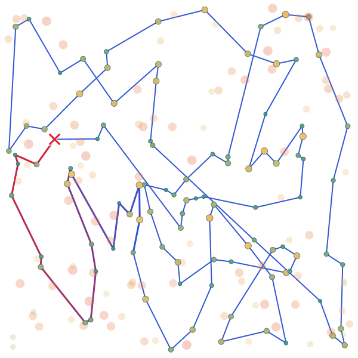
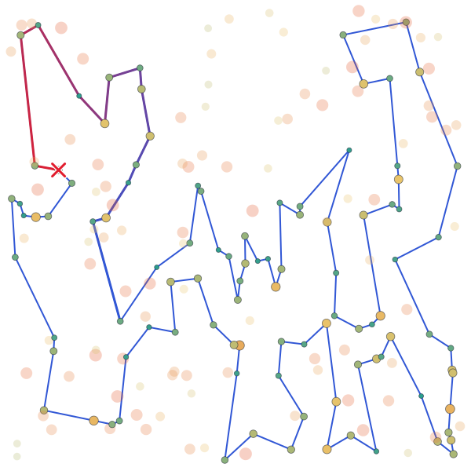
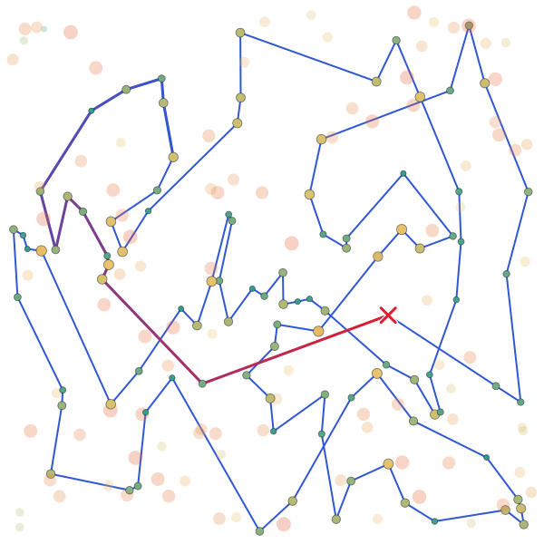
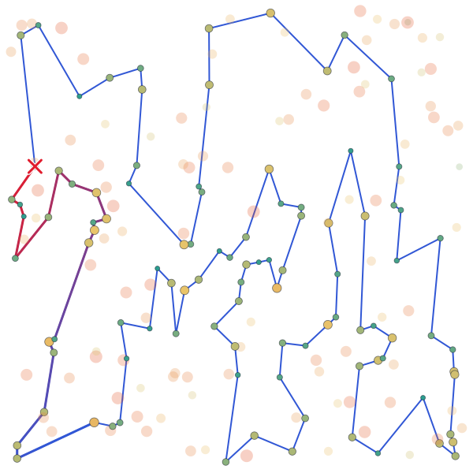
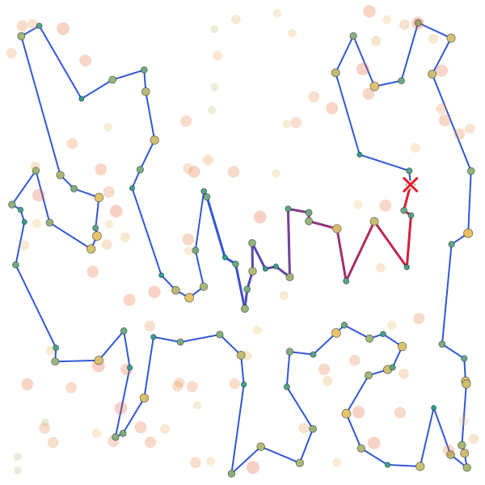


### Visualisation (Instance TSPB)

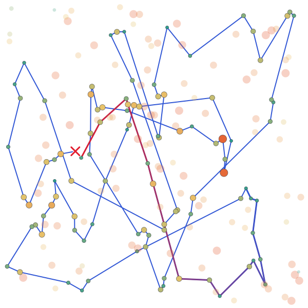
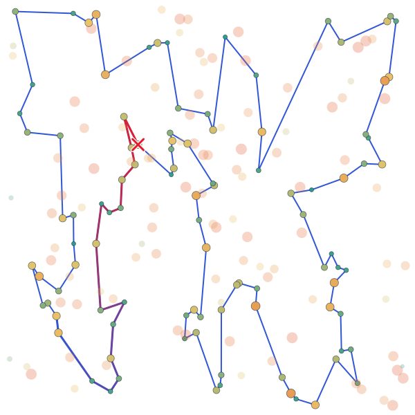
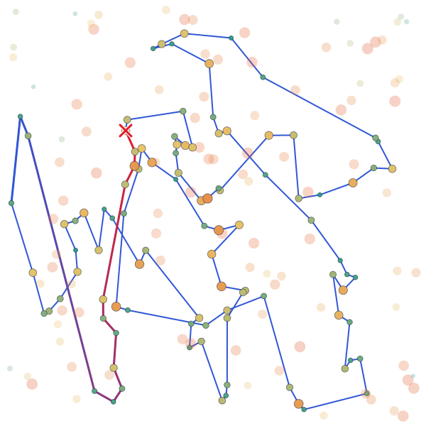
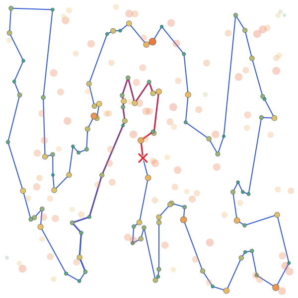
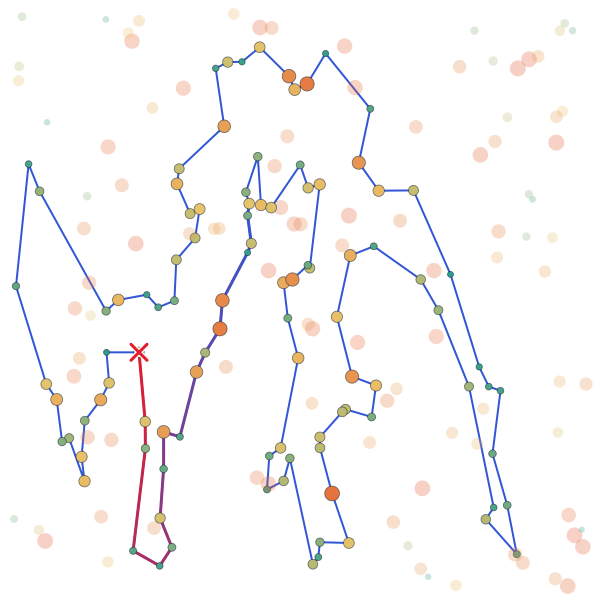
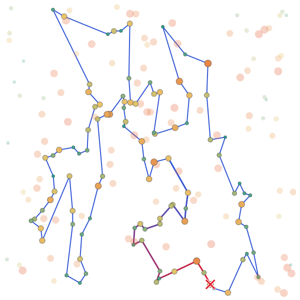
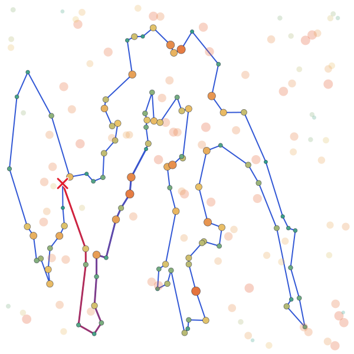


<!-- /auto:results -->

## Running time

<!-- auto:times (generated: edits between these markers are overwritten) -->
Average time of one run of the algorithm only, over the same runs as above. The fastest language in each row is in bold.

### Instance TSPA

| Method | Python | C | C++ | Rust |
|---|--:|--:|--:|--:|
| Steepest LS, nodes exchange, random start | 336.9 ms | 4.69 ms | **4.31 ms** | 6.62 ms |
| Steepest LS, edges exchange, random start | 255.2 ms | 3.48 ms | **3.38 ms** | 4.13 ms |
| Greedy LS, nodes exchange, random start | 70.59 ms | 1.29 ms | **1.26 ms** | 1.37 ms |
| Greedy LS, edges exchange, random start | 44.41 ms | 0.8554 ms | **0.8143 ms** | 0.8704 ms |
| Steepest LS, nodes exchange, greedy start | 45.03 ms | 0.9084 ms | **0.8863 ms** | 0.9632 ms |
| Steepest LS, edges exchange, greedy start | 43.54 ms | 0.8906 ms | **0.8749 ms** | 0.9478 ms |
| Greedy LS, nodes exchange, greedy start | 52.27 ms | 1.08 ms | **1.05 ms** | 1.13 ms |
| Greedy LS, edges exchange, greedy start | 50.53 ms | 1.06 ms | **1.04 ms** | 1.11 ms |
| Steepest LS, edges exchange, candidate moves, random start | 54.18 ms | **0.6827 ms** | 1.24 ms | 1.03 ms |

### Pareto plot (Instance TSPA)


### Instance TSPB

| Method | Python | C | C++ | Rust |
|---|--:|--:|--:|--:|
| Steepest LS, nodes exchange, random start | 329.3 ms | 4.57 ms | **4.37 ms** | 5.46 ms |
| Steepest LS, edges exchange, random start | 294.9 ms | 3.54 ms | **3.44 ms** | 4.28 ms |
| Greedy LS, nodes exchange, random start | 74.65 ms | 1.34 ms | **1.27 ms** | 1.29 ms |
| Greedy LS, edges exchange, random start | 48.77 ms | **0.8300 ms** | 0.8732 ms | 0.9377 ms |
| Steepest LS, nodes exchange, greedy start | 52.11 ms | 1.05 ms | **1.00 ms** | 1.10 ms |
| Steepest LS, edges exchange, greedy start | 59.17 ms | 1.12 ms | **1.04 ms** | 1.16 ms |
| Greedy LS, nodes exchange, greedy start | 57.89 ms | 1.17 ms | **1.12 ms** | 1.23 ms |
| Greedy LS, edges exchange, greedy start | 59.31 ms | 1.21 ms | **1.18 ms** | 1.26 ms |
| Steepest LS, edges exchange, candidate moves, random start | 56.34 ms | **0.6627 ms** | 1.17 ms | 0.9814 ms |

### Pareto plot (Instance TSPB)


<!-- /auto:times -->

## Best solutions (0-based node indices)

<!-- auto:solutions (generated: edits between these markers are overwritten) -->
### Instance TSPA

**Steepest LS, edges exchange, candidate moves, random start**
55, 17, 29, 178, 24, 136, 186, 184, 164, 142, 194, 54, 9, 33, 131, 36, 177, 52, 179, 53, 140, 144, 67, 16, 51, 139, 112, 115, 157, 71, 4, 76, 132, 91, 80, 48, 31, 60, 116, 149, 63, 168, 11, 49, 108, 152, 100, 90, 123, 97, 127, 69, 171, 2, 189, 27, 87, 141, 187, 30, 191, 180, 28, 35, 185, 45, 73, 135, 181, 192, 158, 20, 58, 84, 134, 176, 174, 150, 106, 89, 151, 182, 57, 64, 88, 78, 153, 170, 159, 130, 107, 113, 93, 50, 3, 169, 1, 47, 147, 101

### Instance TSPB

**Steepest LS, edges exchange, candidate moves, random start**
156, 89, 57, 86, 46, 72, 117, 8, 122, 151, 173, 184, 3, 135, 76, 162, 192, 54, 187, 70, 190, 81, 94, 105, 61, 196, 114, 10, 127, 80, 129, 90, 118, 110, 2, 14, 153, 20, 74, 17, 171, 39, 99, 88, 87, 82, 179, 67, 24, 34, 152, 181, 167, 73, 59, 51, 85, 107, 45, 134, 175, 157, 60, 40, 71, 155, 6, 197, 29, 132, 103, 178, 65, 145, 28, 149, 158, 26, 125, 177, 170, 115, 97, 154, 140, 47, 38, 21, 30, 183, 69, 160, 172, 136, 133, 120, 121, 198, 96, 48
<!-- /auto:solutions -->

## Source code

<!-- auto:source (generated: edits between these markers are overwritten) -->
[labs/lab4](https://github.com/mi-zuri/ec-labs/tree/main/labs/lab4) ([Python](https://github.com/mi-zuri/ec-labs/blob/main/labs/lab4/python/solver.py), [C](https://github.com/mi-zuri/ec-labs/blob/main/labs/lab4/c/solver.c), [C++](https://github.com/mi-zuri/ec-labs/blob/main/labs/lab4/cpp/solver.cpp), [Rust](https://github.com/mi-zuri/ec-labs/blob/main/labs/lab4/rust/solver.rs))
<!-- /auto:source -->

## Number of candidates (extra experiment)

The assignment fixes 10 candidates but allows choosing it experimentally. Same 200 random starts, C implementation, average objective and average time per run:

| Candidates | TSPA | TSPB | time TSPA |
|--:|--:|--:|--:|
| 5 | 86531 | 53894 | 0.41 ms |
| **10** (reported above) | 80062 | 52560 | 0.78 ms |
| 15 | 77578 | 52429 | 1.08 ms |
| 20 | 76423 | 52480 | 1.41 ms |
| 30 | 76235 | 52437 | 2.27 ms |
| 199 (all nodes) | 76224 | 52461 | 15.48 ms |
| baseline (lab 3) | 76225 | 52461 | 3.48 ms |

With all 199 nodes as candidates the method finds the same local optima as the baseline (it differs only in the order of equal moves), which confirms that the candidate moves are generated correctly; it is slower because every edge is reached from both of its ends. About 20 candidates keep the baseline quality at 2.5× the speed.

## Conclusions

- Candidate moves cost little quality on TSPB (52 560 vs 52 461 on average) but 5 % on TSPA (80 062 vs 76 225), where the improving moves more often need an edge outside the 10 nearest nodes; 20 candidates close that gap (76 423).
- The best single solution of TSPB so far comes from candidate moves (49 902, below 49 955 of greedy LS in lab 3), while on TSPA the greedy-start local searches of lab 3 stay best (72 971 on average).
- Evaluating at most 2 000 instead of 14 950 moves per step makes steepest LS about 5× faster (C: 0.68 ms vs 3.48 ms on TSPA, Python: 54 ms vs 255 ms); lab 3's greedy LS and greedy-start methods stay faster only because they evaluate fewer moves in total (greedy LS stops at the first improving move, greedy starts are already near a local optimum), not because their steps are cheaper.
