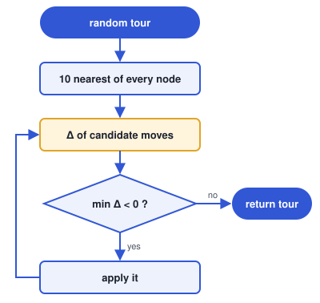
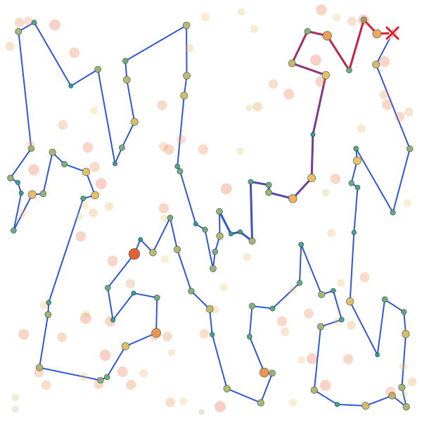
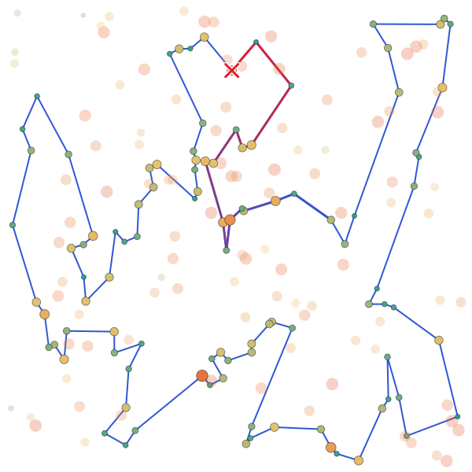
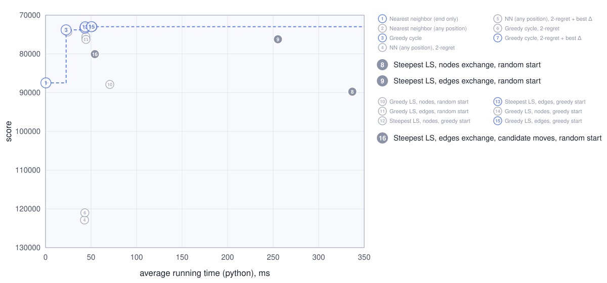
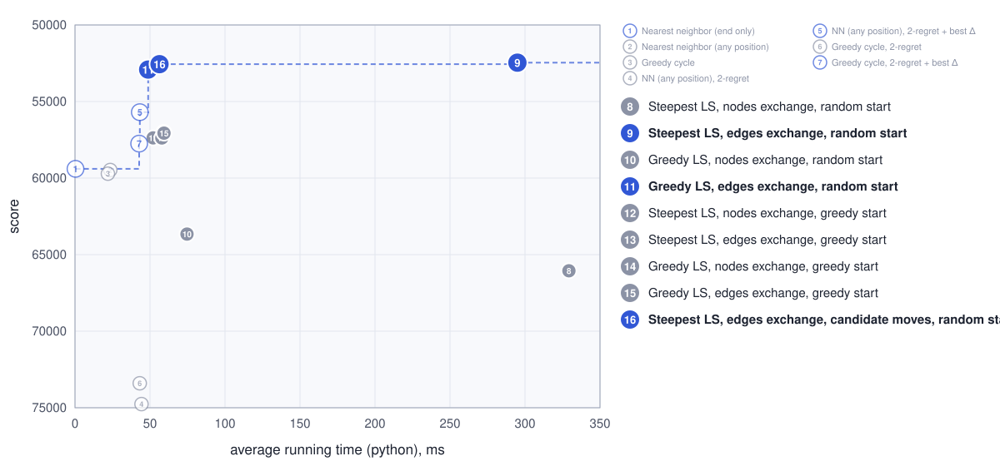
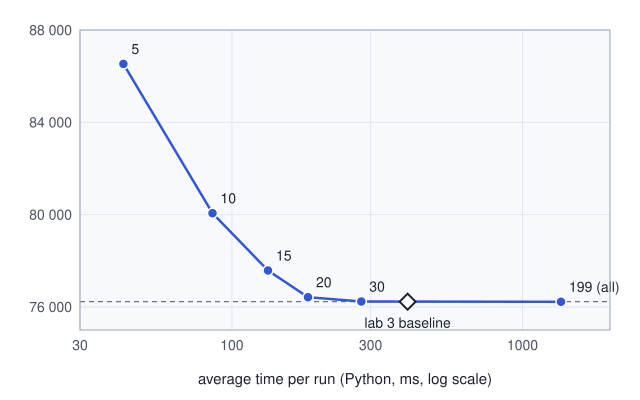
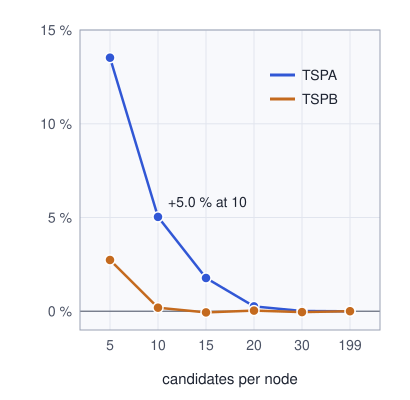

# Lab 4 - Candidate moves

Author: Michał Żurawski 160252

## Description of the problem

Each instance has n = 200 nodes with coordinates (x, y) and a cost. Select exactly **half of the nodes** (k = 100) and connect them into a **closed cycle** that minimises **cycle length + sum of node costs**. Distances are Euclidean, rounded to integers.

## Algorithms

**Steepest local search** with lab 3's best neighborhood (**inter-route node exchange + edges exchange**), started from the same **random tours** as lab 3 (run i uses seed 42 + i). Each step evaluates only **candidate moves**: the moves that add an edge to one of the **10 nearest nodes**.

### Intuition

**Problem:** steepest LS spends almost all its time on hopeless moves: in a good tour nearly every edge joins a node to one of its few nearest nodes, so a move that adds an edge to a far node almost never improves.

**Idea:** keep for every node its 10 nearest nodes and evaluate only the moves that bring one of these short edges into the tour: at most 100 · 10 · 2 = 2 000 instead of 14 950 moves per step. The improving moves it skips cost a little quality.

### Core calculations

<!-- columns -->
We calculate **Δ = the change of the objective** only for **candidate moves**, the moves that add a **candidate edge** (a, b) with b ∈ N(a): N(a) = the 10 nodes b ≠ a with the smallest `d(a,b) + c(b)`. p(x), s(x) = predecessor, successor of x.

**Node exchange**, b not in the tour replaces s = s(a) (or symmetrically p(a)), t = s(s):

`Δ = c(b) − c(s) + d(a,b) + d(b,t) − d(a,s) − d(s,t)`

**Edges exchange**, b in the tour, with the successors (or symmetrically the predecessors):

`Δ = d(a,b) + d(s(a),s(b)) − d(a,s(a)) − d(b,s(b))`

The move with the **lowest Δ** is applied if Δ < 0; otherwise the tour is a local optimum.

<!-- column -->

<!-- /columns -->

<!-- pagebreak -->
### Complexity

| Method | Complexity per step | Δ per run |
|---|---|--:|
| Steepest LS, edges exchange, random start | O(nk) | 2 003 300 |
| Steepest LS, edges exchange, candidate moves, random start | O(k), lists O(n² log n) | 227 305 |

Δ per run is the TSPA average over 200 runs.

#### Explanation

- **Full steepest search:** every step computes the Δ of every move, k(n − k) inter-route + k(k − 1)/2 intra-route ≤ nk → **O(nk)** per step: `k(n − k) + k(k − 1)/2 = 14 950`; 134 steps per run.
- **Candidate moves:** a step computes Δ only for moves adding a candidate edge, 2 moves for each of the 10 candidates of each of the k tour nodes → **O(k)** per step: at most `2 × 10 × k = 2 000` (about 1 800 on average); 126 steps per run. Once per run the 10 candidates of every node are found by sorting → **lists O(n² log n)**.
- So **candidate moves compute 8.8× fewer Δ than the full search** from the same random starts.

### Pseudocode

Simplified from `python/solver.py`. `local_search` is lab 3's steepest loop; only the move search changed: `find_best_candidate_move` generates the moves from the candidate lists instead of scanning a fixed list of all moves, so `position[v]` (index of v in the tour, or `NOT_SELECTED`) is kept up to date by `apply_move`.

```
def solve(seed):
    candidates = nearest_candidates()            # N(a) for every node a
    tour = random_start(rng(seed))               # same start as lab 3
    return local_search(tour, candidates)

def local_search(tour, candidates):
    position = tour_positions(tour)
    while True:
        move = find_best_candidate_move(tour, position, candidates)
        if move is None:
            return tour                          # local optimum
        apply_move(tour, position, move)

def find_best_candidate_move(tour, position, candidates):
    best_move, best_delta = None, 0
    for i, a in enumerate(tour):
        for b in candidates[a]:
            for move in moves_adding_edge(tour, position, i, b):
                delta = move_delta(tour, move)
                if delta < best_delta:
                    best_move, best_delta = move, delta
    return best_move

def moves_adding_edge(tour, position, i, b):
    successor, predecessor = i + 1, i - 1         # modulo k
    j = position[b]
    if j == NOT_SELECTED:                        # b enters next to a
        return [(EXCHANGE_SELECTED, successor, b), (EXCHANGE_SELECTED, predecessor, b)]
    if j == successor or j == predecessor:
        return []                                # edge (a, b) already in the tour
    return [edges_exchange(i, j),                # adds (a, b) and (succ a, succ b)
            edges_exchange(predecessor, j - 1)]  # adds (pred a, pred b) and (a, b)

def apply_move(tour, position, move):
    kind, i, j = move
    if kind == EXCHANGE_SELECTED: tour[i] = j, update position of the old and new node
    if kind == SWAP_EDGES:        reverse tour[i+1 .. j], update positions in it
```

**Why only these moves.** An exchange that replaces a itself with b would not create edge (a, b), so b replaces a neighbour of a instead. Each candidate edge can be added by exactly two moves, both of one kind: two node exchanges if b is not in the tour, two edges exchanges if it is. They are generated directly, so no move outside the candidate set is ever looked at.

## Results

<!-- auto:results (generated: edits between these markers are overwritten) -->
Objective = cycle length + node costs, 200 runs per method. Cells: av (min – max), best of each per instance in bold.
All best solutions were checked with the solution checker: **yes**.
Results are identical in all implemented languages: **yes**.

| Method | TSPA | TSPB |
|---|:-:|:-:|
| Steepest LS, edges exchange, random start | 76225 (74248 – 79388) | **52461** (50265 – **55173**) |
| Steepest LS, edges exchange, greedy start | **72997** (**71955** – **74682**) | 57019 (52566 – 62301) |
| Steepest LS, edges exchange, candidate moves, random start | 80062 (76007 – 85627) | 52560 (**49902** – 55299) |

### Visualisation (Instance TSPA)




### Visualisation (Instance TSPB)



<!-- /auto:results -->

## Running time

<!-- auto:times (generated: edits between these markers are overwritten) -->
Average time of one run **in ms** (algorithm only, same runs as above); the fastest language per row is in bold.

### Instance TSPA

| Method | Python | C | C++ | Rust |
|---|--:|--:|--:|--:|
| Steepest LS, edges exchange, random start | 255.24 | 3.48 | **3.38** | 4.13 |
| Steepest LS, edges exchange, greedy start | 43.54 | 0.89 | **0.87** | 0.95 |
| Steepest LS, edges exchange, candidate moves, random start | 54.18 | **0.68** | 1.24 | 1.03 |

### Pareto plot (Instance TSPA)



### Instance TSPB

| Method | Python | C | C++ | Rust |
|---|--:|--:|--:|--:|
| Steepest LS, edges exchange, random start | 294.92 | 3.54 | **3.44** | 4.28 |
| Steepest LS, edges exchange, greedy start | 59.17 | 1.12 | **1.04** | 1.16 |
| Steepest LS, edges exchange, candidate moves, random start | 56.34 | **0.66** | 1.17 | 0.98 |

### Pareto plot (Instance TSPB)


<!-- /auto:times -->

## Best solutions (0-based node indices)

<!-- auto:solutions (generated: edits between these markers are overwritten) -->
### Instance TSPA

**Steepest LS, edges exchange, candidate moves, random start**
55, 17, 29, 178, 24, 136, 186, 184, 164, 142, 194, 54, 9, 33, 131, 36, 177, 52, 179, 53, 140, 144, 67, 16, 51, 139, 112, 115, 157, 71, 4, 76, 132, 91, 80, 48, 31, 60, 116, 149, 63, 168, 11, 49, 108, 152, 100, 90, 123, 97, 127, 69, 171, 2, 189, 27, 87, 141, 187, 30, 191, 180, 28, 35, 185, 45, 73, 135, 181, 192, 158, 20, 58, 84, 134, 176, 174, 150, 106, 89, 151, 182, 57, 64, 88, 78, 153, 170, 159, 130, 107, 113, 93, 50, 3, 169, 1, 47, 147, 101

### Instance TSPB

**Steepest LS, edges exchange, candidate moves, random start**
156, 89, 57, 86, 46, 72, 117, 8, 122, 151, 173, 184, 3, 135, 76, 162, 192, 54, 187, 70, 190, 81, 94, 105, 61, 196, 114, 10, 127, 80, 129, 90, 118, 110, 2, 14, 153, 20, 74, 17, 171, 39, 99, 88, 87, 82, 179, 67, 24, 34, 152, 181, 167, 73, 59, 51, 85, 107, 45, 134, 175, 157, 60, 40, 71, 155, 6, 197, 29, 132, 103, 178, 65, 145, 28, 149, 158, 26, 125, 177, 170, 115, 97, 154, 140, 47, 38, 21, 30, 183, 69, 160, 172, 136, 133, 120, 121, 198, 96, 48
<!-- /auto:solutions -->

## Source code

<!-- auto:source (generated: edits between these markers are overwritten) -->
[labs/lab4](https://github.com/mi-zuri/ec-labs/tree/main/labs/lab4) ([Python](https://github.com/mi-zuri/ec-labs/blob/main/labs/lab4/python/solver.py), [C](https://github.com/mi-zuri/ec-labs/blob/main/labs/lab4/c/solver.c), [C++](https://github.com/mi-zuri/ec-labs/blob/main/labs/lab4/cpp/solver.cpp), [Rust](https://github.com/mi-zuri/ec-labs/blob/main/labs/lab4/rust/solver.rs))
<!-- /auto:source -->

## Number of candidates (extra experiment)

The assignment fixes 10 candidates but allows choosing it experimentally. Same 200 random starts, Python implementation, objective av (min – max) and average time per run (timings come from a separate run, so the 10-candidate time differs slightly from the table above):

| Candidates | TSPA | TSPB | time TSPA | time TSPB |
|--:|--:|--:|--:|--:|
| 5 | 86531 (80176 – 91338) | 53894 (51266 – 56792) | 42 ms | 46 ms |
| **10** (reported above) | 80062 (76007 – 85627) | 52560 (49902 – 55299) | 86 ms | 94 ms |
| 15 | 77578 (74096 – 81478) | 52429 (50177 – 55464) | 133 ms | 143 ms |
| 20 | 76423 (74099 – 80271) | 52480 (50265 – 54993) | 183 ms | 189 ms |
| 30 | 76235 (74248 – 79270) | 52437 (50265 – 55410) | 279 ms | 265 ms |
| 199 (all nodes) | 76224 (74248 – 79388) | 52461 (50265 – 55410) | 1357 ms | 1294 ms |
| baseline (lab 3) | 76225 (74248 – 79388) | 52461 (50265 – 55173) | 402 ms | 356 ms |

<!-- columns -->

<!-- column -->

<!-- /columns -->

## Conclusions

- **Candidate moves cost little quality** on TSPB (52 560 vs 52 461 on average) but 5 % on TSPA (80 062 vs 76 225), where the improving moves more often need an edge outside the 10 nearest nodes; 20 candidates close that gap.
- Evaluating at most 2 000 instead of 14 950 moves per step makes steepest LS **2.7–5.3× faster** depending on the language (C: 0.68 ms vs 3.48 ms on TSPA, Python: 54 ms vs 255 ms).
- The best single solution of TSPB so far comes from **candidate moves** (49 902, below 49 955 of greedy LS in lab 3).
