# Lab 5 - List of improving moves

Author: Michał Żurawski 160252

## Description of the problem

Each instance has n = 200 nodes with coordinates (x, y) and a cost. Select exactly **half of the nodes** (k = 100) and connect them into a **closed cycle** that minimises **cycle length + sum of node costs**. Distances are Euclidean, rounded to integers.

## Algorithms

**Steepest local search** with lab 3's best neighborhood (**inter-route node exchange + edges exchange**) from lab 3's **random tours** (seed 42 + i), reusing the improving moves of one evaluation from a **list of improving moves (LM)**.

### Intuition

**Problem:** steepest LS evaluates all 14 950 moves again after every move, although one move changes only a few edges, so almost every result is the same as one step before.

**Idea:** keep the improving moves found in a list, best first, and apply them while they still fit the tour; the whole neighborhood is evaluated again only when none fits: on TSPA 9 instead of 134 times per run. The tours are as good as with the full search.

### Core calculations

<!-- columns -->
For every move we calculate **Δ = the change of the objective** (Δ < 0: improving). **LM** keeps the improving moves, best first, stored by the **nodes of the removed edges**, not by positions.

**Node exchange**, selected v (between p and s) → unselected u:
`Δ = c(u) − c(v) + d(p,u) + d(u,s) − d(p,v) − d(v,s)`

**Edges exchange**, remove a→b, c→d, both relative directions:
`Δ = d(a,c) + d(b,d) − d(a,b) − d(c,d)` same
`Δ = d(a,d) + d(b,c) − d(a,b) − d(c,d)` inverted

Δ uses only these nodes, so a **stored Δ stays exact** while its removed edges are in the tour. **Browsing LM** from the best:

| Removed edges in the tour | Action |
|---|---|
| at least one missing | remove from LM |
| relatively reversed | keep, browse further |
| same relative direction | apply, remove from LM |
<!-- column -->
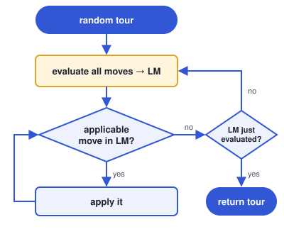
<!-- /columns -->

<!-- pagebreak -->
### Complexity

| Method | Complexity per step | Δ per run |
|---|---|--:|
| Steepest LS, edges exchange, random start | O(nk) | 2 003 300 |
| Steepest LS, edges exchange, candidate moves, random start | O(k), lists O(n² log n) | 227 305 |
| Steepest LS, edges exchange, list of improving moves, random start | browse ≤ O(nk), rebuild O(nk log nk) | 177 201 |

Δ per run is the TSPA average over 200 runs.

#### Explanation

- **Full steepest search:** every step computes the Δ of every move, k(n − k) inter-route + k(k − 1)/2 intra-route ≤ nk → **O(nk)** per step: `k(n − k) + k(k − 1)/2 = 14 950`; 134 steps per run.
- **Candidate moves:** a step computes Δ only for moves adding a candidate edge, 2 moves for each of the 10 candidates of each of the k tour nodes → **O(k)** per step: at most `2 × 10 × k = 2 000` (about 1 800 on average); 126 steps per run. Once per run the 10 candidates of every node are found by sorting → **lists O(n² log n)**.
- **LM:** a step computes no Δ; it browses LM from the best, O(1) per stored move and at most all of them → **browse ≤ O(nk)**, then applies the move in O(k). Only when no stored move is applicable, a rebuild computes the Δ of both directions of every edge pair, `k(n − k) + k(k − 3) = 19 700`, and sorts the improving ones → **rebuild O(nk log nk)**; 9 rebuilds for 154 moves per run.
- So **LM computes 11× fewer Δ than the full search** and slightly fewer than candidate moves, but it also pays for sorting and browsing LM.

### Pseudocode

Simplified from `python/solver.py`, the alternative algorithm of the assignment. The assignment's "add improving moves to LM" is done by rebuilding LM: the moves left in LM are found again by the full evaluation with the same Δ, so the result is the same without duplicates. The search stops when a freshly evaluated LM has no applicable move: the tour is then a local optimum of the full neighborhood, as in lab 3.

```
def solve(seed):
    tour = random_start(rng(seed))               # same start as lab 3
    return local_search(tour)

def local_search(tour):
    while True:
        moves = evaluate_all_moves(tour)         # LM
        move = take_applicable_move(moves, tour)
        if move is None:
            return tour                          # local optimum
        while move is not None:                  # reuse LM without evaluating again
            apply_move(tour, move)
            move = take_applicable_move(moves, tour)

def evaluate_all_moves(tour):
    moves = []
    for every v in tour (between p and s), every unselected u:
        add (Δ, EXCHANGE_SELECTED, p, v, s, u) if Δ < 0
    for every pair of non-adjacent tour edges a -> b, c -> d:
        add (Δ, SWAP_EDGES, a, b, c, d) if Δ < 0     # same relative direction
        add (Δ, SWAP_EDGES, a, b, d, c) if Δ < 0     # relatively inverted
    return moves sorted from the best

def take_applicable_move(moves, tour):
    for move in moves, from the best:
        status = move_status(tour, move)
        if status == OBSOLETE:   remove move from moves
        if status == APPLICABLE: remove move from moves; return move
        # NOT_APPLICABLE_NOW: keep it, browse further
    return None

def move_status(tour, move):                     # edge_direction: +1 x -> y, -1 y -> x, 0 no edge
    if move is (EXCHANGE_SELECTED, p, v, s, u):
        if edge_direction(p, v) == 0 or edge_direction(v, s) == 0 or u in tour:
            return OBSOLETE
        return APPLICABLE                        # p, v, s consecutive: same direction
    if move is (SWAP_EDGES, a, b, c, d):
        first, second = edge_direction(a, b), edge_direction(c, d)
        if first == 0 or second == 0: return OBSOLETE
        if first != second:           return NOT_APPLICABLE_NOW
        return APPLICABLE

def apply_move(tour, move):
    if EXCHANGE_SELECTED: u takes the position of v
    if SWAP_EDGES:        i, j = positions of a and c (or of b and d if both edges are reversed)
                          reverse tour[i+1 .. j]
```

**Implementation note.** LM is stored worst first, so the best move is at the end of the array: the ~11 400 removals per run then shift only a few kept moves, not the whole list (best-first storage made C, C++ and Rust as slow as Python).

## Results

<!-- auto:results (generated: edits between these markers are overwritten) -->
Objective = cycle length + node costs, 200 runs per method. Cells: av (min – max), best of each per instance in bold.
All best solutions were checked with the solution checker: **yes**.
Results are identical in all implemented languages: **yes**.

| Method | TSPA | TSPB |
|---|:-:|:-:|
| Steepest LS, edges exchange, random start | 76225 (74248 – 79388) | **52461** (50265 – **55173**) |
| Steepest LS, edges exchange, greedy start | **72997** (**71955** – **74682**) | 57019 (52566 – 62301) |
| Steepest LS, edges exchange, candidate moves, random start | 80062 (76007 – 85627) | 52560 (**49902** – 55299) |
| Steepest LS, edges exchange, list of improving moves, random start | 76119 (73975 – 79089) | 52493 (50369 – 55548) |

### Visualisation (Instance TSPA)

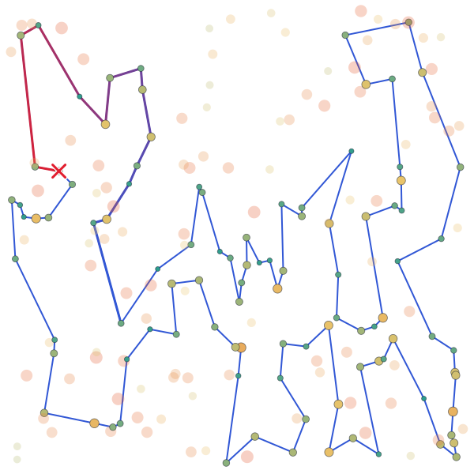
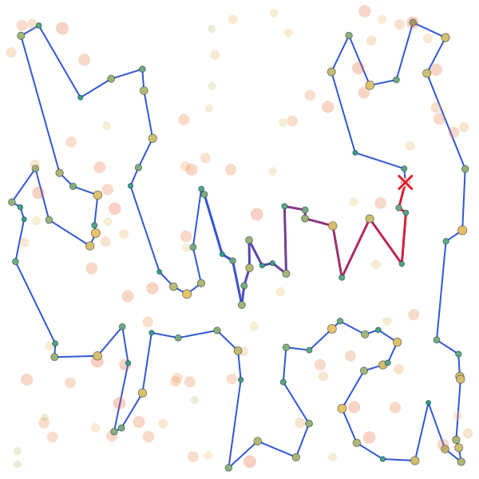
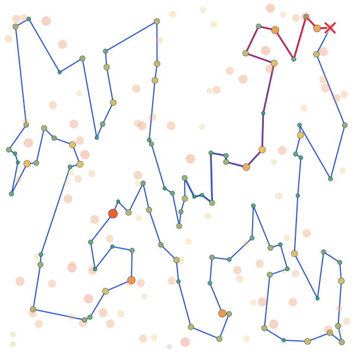
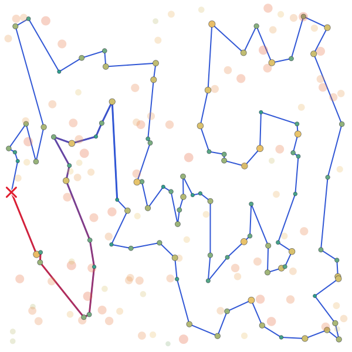

### Visualisation (Instance TSPB)

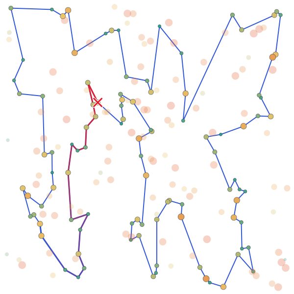
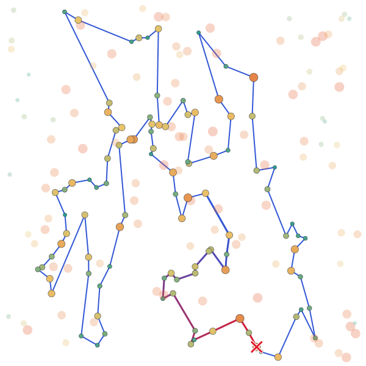
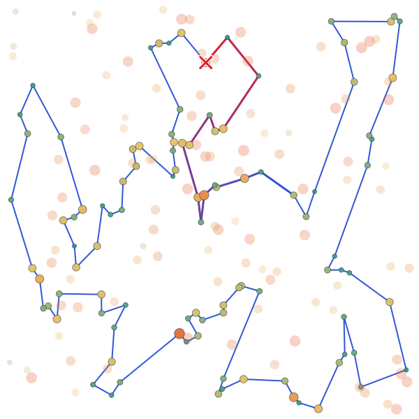
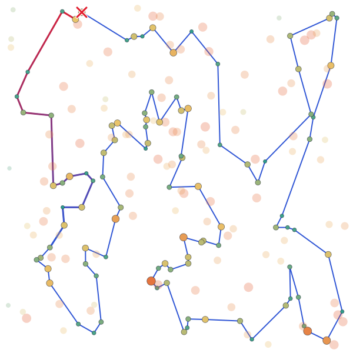
<!-- /auto:results -->

## Running time

<!-- auto:times (generated: edits between these markers are overwritten) -->
Average time of one run **in ms** (algorithm only, same runs as above); the fastest language per row is in bold.

### Instance TSPA

| Method | Python | C | C++ | Rust |
|---|--:|--:|--:|--:|
| Steepest LS, edges exchange, random start | 255.24 | 3.48 | **3.38** | 4.13 |
| Steepest LS, edges exchange, greedy start | 43.54 | 0.89 | **0.87** | 0.95 |
| Steepest LS, edges exchange, candidate moves, random start | 54.18 | **0.68** | 1.24 | 1.03 |
| Steepest LS, edges exchange, list of improving moves, random start | 19.08 | 1.10 | 0.96 | **0.92** |

### Pareto plot (Instance TSPA)

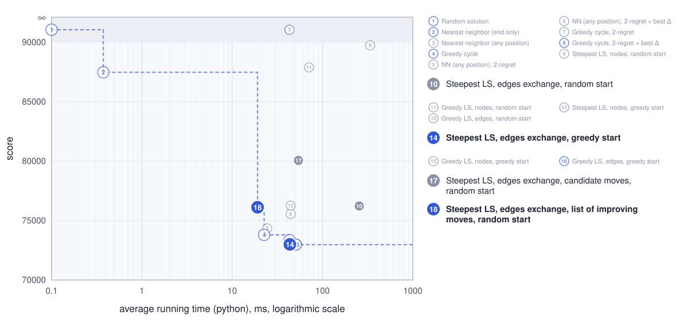

### Instance TSPB

| Method | Python | C | C++ | Rust |
|---|--:|--:|--:|--:|
| Steepest LS, edges exchange, random start | 294.92 | 3.54 | **3.44** | 4.28 |
| Steepest LS, edges exchange, greedy start | 59.17 | 1.12 | **1.04** | 1.16 |
| Steepest LS, edges exchange, candidate moves, random start | 56.34 | **0.66** | 1.17 | 0.98 |
| Steepest LS, edges exchange, list of improving moves, random start | 19.28 | 0.94 | 0.81 | **0.77** |

### Pareto plot (Instance TSPB)

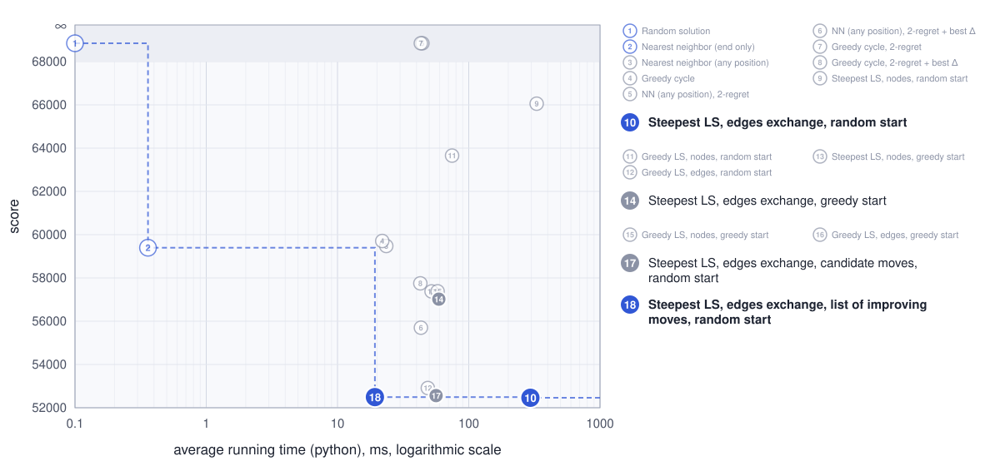
<!-- /auto:times -->

## Best solutions (0-based node indices)

<!-- auto:solutions (generated: edits between these markers are overwritten) -->
### Instance TSPA

**Steepest LS, edges exchange, list of improving moves, random start**
168, 95, 97, 127, 171, 2, 187, 30, 160, 123, 152, 100, 132, 76, 4, 180, 28, 141, 87, 45, 73, 135, 181, 192, 158, 138, 182, 57, 64, 88, 78, 153, 107, 170, 146, 159, 130, 47, 147, 101, 55, 29, 178, 184, 136, 186, 154, 62, 143, 33, 9, 54, 8, 142, 164, 1, 169, 3, 50, 93, 106, 113, 89, 42, 151, 150, 174, 176, 72, 134, 58, 84, 131, 36, 177, 52, 179, 53, 140, 144, 67, 185, 35, 156, 16, 51, 139, 112, 71, 157, 91, 80, 48, 31, 108, 49, 60, 116, 149, 63

### Instance TSPB

**Steepest LS, edges exchange, list of improving moves, random start**
42, 147, 116, 149, 28, 145, 158, 177, 125, 26, 154, 140, 97, 170, 115, 6, 29, 132, 197, 36, 175, 134, 45, 60, 71, 155, 40, 33, 64, 47, 38, 21, 30, 183, 69, 160, 172, 136, 133, 120, 117, 72, 46, 86, 184, 3, 151, 27, 66, 67, 24, 34, 25, 152, 181, 167, 73, 59, 107, 85, 51, 82, 87, 179, 88, 99, 171, 74, 20, 153, 14, 2, 9, 93, 110, 118, 90, 129, 80, 127, 10, 114, 61, 105, 94, 81, 70, 187, 196, 54, 192, 162, 76, 57, 89, 156, 48, 96, 198, 121
<!-- /auto:solutions -->

## Source code

<!-- auto:source (generated: edits between these markers are overwritten) -->
[labs/lab5](https://github.com/mi-zuri/ec-labs/tree/main/labs/lab5) ([Python](https://github.com/mi-zuri/ec-labs/blob/main/labs/lab5/python/solver.py), [C](https://github.com/mi-zuri/ec-labs/blob/main/labs/lab5/c/solver.c), [C++](https://github.com/mi-zuri/ec-labs/blob/main/labs/lab5/cpp/solver.cpp), [Rust](https://github.com/mi-zuri/ec-labs/blob/main/labs/lab5/rust/solver.rs))
<!-- /auto:source -->

## Conclusions

- **LM reaches the quality of the full steepest search** (76 119 vs 76 225 on TSPA, 52 493 vs 52 461 on TSPB). Both end in a local optimum of the same neighborhood; only the order of the applied moves differs, because moves created after the last evaluation wait for the next one.
- Evaluating the neighborhood 9 instead of 134 times per run makes the search **3.2–5.6× faster** in C, C++ and Rust and **13–15× faster** in Python (19 ms vs 255–295 ms). In Python almost all the time is spent on evaluations, while compiled code also pays for sorting and browsing LM.
- Compared with candidate moves (lab 4), LM is **about as fast** (C 1.10 vs 0.68 ms, Rust 0.92 vs 1.03 ms on TSPA) **without their quality loss** on TSPA (76 119 vs 80 062).
- LM speeds the search up but **does not move the best results so far**: on TSPA greedy-start LS from lab 3 is still best on average (72 971), and the best TSPB solution still comes from candidate moves (49 902 vs 50 369 here).
