# Lab 6 - Multiple start and iterated local search

Author: Michał Żurawski 160252

## Description of the problem

Each instance has n = 200 nodes with coordinates (x, y) and a cost. Select exactly **half of the nodes** (k = 100) and connect them into a **closed cycle** that minimises **cycle length + sum of node costs**. Distances are Euclidean, rounded to integers.

## Algorithms

Two extensions of lab 5's **steepest local search with a list of improving moves** (inter-route node exchange + edges exchange): **multiple start local search (MSLS)** keeps the best of independent local searches from **random tours**; **iterated local search (ILS)** starts from one random tour, then repeatedly **perturbs** its local optimum (**double bridge + 3 node exchanges**) and descends again, for the **same time as MSLS**.

### Intuition

**Problem:** MSLS starts every local search from a new random tour, so each one spends most of its moves only repairing a random tour and builds nothing on the good tours found before.

**Idea:** ILS keeps the best local optimum and only kicks it a little, so the next local search starts next to a good tour and needs 13 instead of 153 moves: in the same time it runs 2–8× more local searches, each one trying to improve the best tour. The price is the size of the kick: too small and the search falls back into the same optimum, too large and it is a random restart.

### Core calculations

<!-- columns -->
The new part is the **perturbation y = perturb(x)**: it moves the current local optimum x to a nearby tour y, far enough that the local search does not return to x, close enough to keep most of its good edges. Then y is improved by the lab 5 local search.

**Double bridge**, 3 different random cuts `1 ≤ i < j < l ≤ k − 1` split the tour into A B C D:
`A B C D → A C B D`
It replaces 3 edges, and every part keeps its direction, so one edges exchange (which reverses a part) cannot undo it.

**Node exchange**, 3 times, a random position p and a random unselected node u:
`tour[p] = u`
It changes the set of selected nodes; the double bridge changes only their order. Together at most 3 + 2 × 3 = 9 of the 100 edges change.

**Acceptance:** `x = y if f(y) < f(x)`, f = length + costs.

| | MSLS | ILS |
|---|---|---|
| local search from | new random tour | perturb(x) |
| keeps | best of all | y if strictly better |
| stops after | 400 local searches | time of MSLS |
<!-- column -->
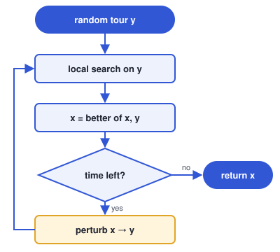
<!-- /columns -->

<!-- pagebreak -->

### Complexity

| Method | Complexity per step | Δ per run |
| --- | --- | --: |
| Steepest LS, edges exchange, list of improving moves, random start | browse ≤ O(nk), rebuild O(nk log nk) | 177 201 |
| MSLS, best of 400 steepest LS with list of moves | O(n) + local search (8.8 rebuilds) | 69 395 220 |
| ILS, double bridge + 3 node exchanges | O(n) + local search (5.4 rebuilds) | 85 673 330 |

Δ per run is the TSPA average over the runs of Results, counted in python/solver.py (ILS: in Python, as its number of local searches depends on the language).

#### Explanation

- **Local search (lab 5):** a step applies one move from LM, browsing it → **browse ≤ O(nk)**; when no stored move is applicable, a rebuild computes the Δ of every move `k(n − k) + k(k − 3) = 19 700` and sorts the improving ones → **rebuild O(nk log nk)**; from a random tour 9 rebuilds for 154 moves per run.
- **MSLS:** a step (one whole local search) builds a random tour (shuffle of n nodes) → **O(n) + local search**, which needs 8.8 rebuilds and 153 moves; 400 steps per run: `3 522.6 rebuilds × 19 700 = 69 395 220`.
- **ILS:** a step perturbs x (double bridge copies k nodes, node exchanges mark n nodes) → **O(n) + local search**, which starts from a tour 9 edges away from a local optimum: 5.4 rebuilds and 13 moves, LM holding 113 instead of 1 360 moves to sort and browse; 806 steps per run in Python: `4 348.9 rebuilds × 19 700 = 85 673 330`.
- So **ILS computes 1.6× fewer Δ per local search than MSLS** and handles a 12× shorter LM: 2× more local searches in the same time in Python, 5–8× in C, C++ and Rust, where Δ are cheap.

### Pseudocode

Simplified from `python/solver.py`; `local_search` is lab 5's, unchanged.

```
def multiple_start_local_search(rng):
    best = None
    repeat MSLS_LOCAL_SEARCHES (400) times:
        tour = local_search(random_start(rng))
        best = better of best, tour
    return best

def iterated_local_search(rng):
    deadline = now + time_limit                  # average time of one MSLS run
    current = local_search(random_start(rng))
    while now < deadline:
        candidate = local_search(perturb(current, rng))
        current = better of current, candidate  # only if strictly better
    return current

def perturb(tour, rng):
    perturbed = double_bridge(tour, rng)
    repeat NODE_EXCHANGES (3) times:             # exchange_random_nodes
        perturbed[random position] = random unselected node
    return perturbed

def double_bridge(tour, rng):
    first, second, third = sorted(3 different random cuts in 1 .. k-1)
    return tour[:first] + tour[second:third] + tour[first:second] + tour[third:]  # A C B D
```

## Results

<!-- auto:results (generated: edits between these markers are overwritten) -->
Objective = cycle length + node costs, 200 runs per method (MSLS, ILS: 20). Cells: av (min – max), best of each per instance in bold.
All best solutions were checked with the solution checker: **yes**.
Results are identical in all implemented languages: **yes** (except ILS: it stops after a time limit, so a faster language runs more iterations; the tables show Python).

| Method | TSPA | TSPB |
|---|:-:|:-:|
| Nearest neighbor (any position), 2-regret + best change | 75561 (72419 – 78504) | 55698 (50485 – 61406) |
| Greedy cycle, 2-regret + best change | 73350 (72011 – 75532) | 57751 (52906 – 63326) |
| Steepest LS, edges exchange, greedy start | 72997 (71955 – 74682) | 57019 (52566 – 62301) |
| Steepest LS, edges exchange, list of improving moves, random start | 76119 (73975 – 79089) | 52493 (50369 – 55548) |
| MSLS, best of 400 steepest LS with list of moves | 73560 (72909 – 74035) | 50225 (49838 – 50599) |
| ILS, double bridge + 3 node exchanges | **71854** (**71502** – **72255**) | **48414** (**48162** – **48974**) |

### Runs of basic local search per run

Cells: av (min – max) over the runs, Python (the language of the tables above).

| Method | TSPA | TSPB |
|---|:-:|:-:|
| MSLS, best of 400 steepest LS with list of moves | 400 (400 – 400) | 400 (400 – 400) |
| ILS, double bridge + 3 node exchanges | 806 (751 – 880) | 896 (844 – 935) |

### Visualisation (Instance TSPA)

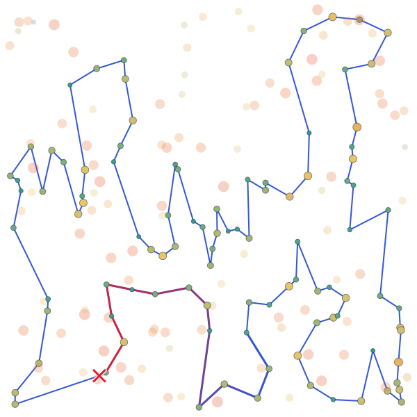
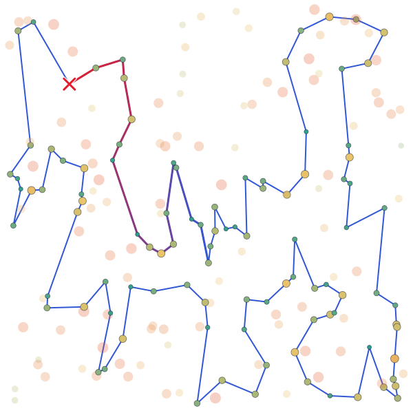
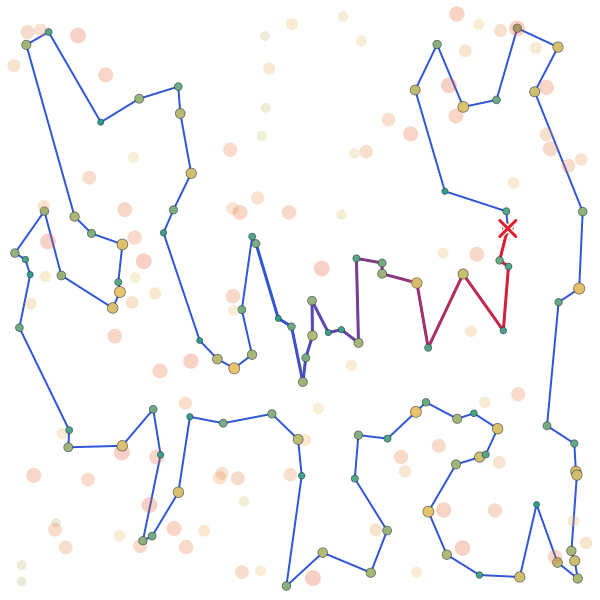
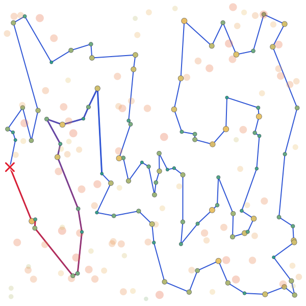
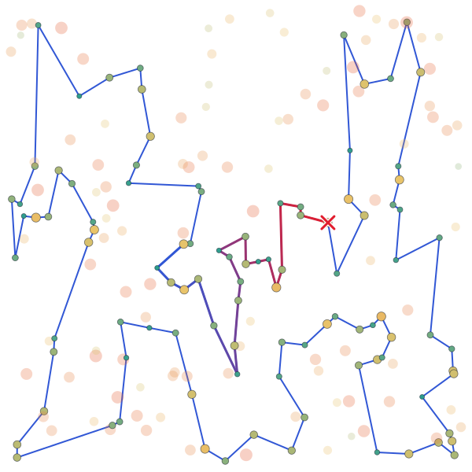
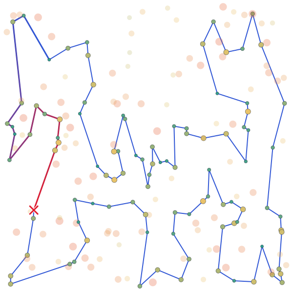

### Visualisation (Instance TSPB)

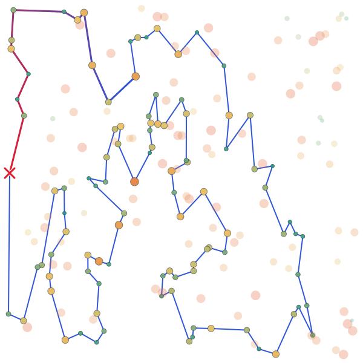
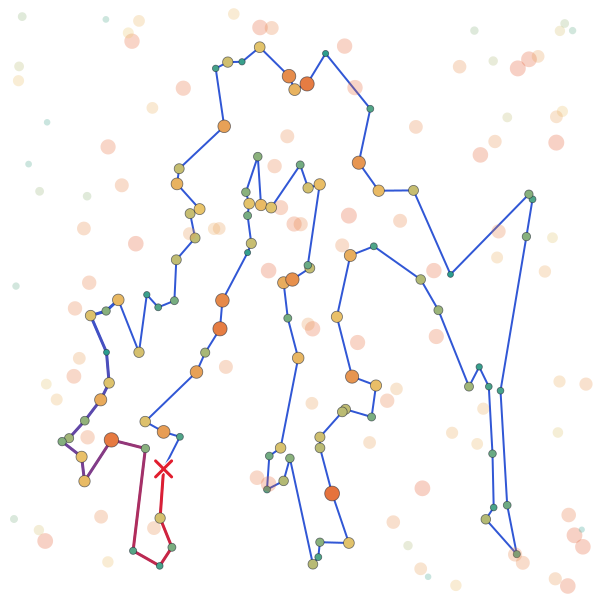
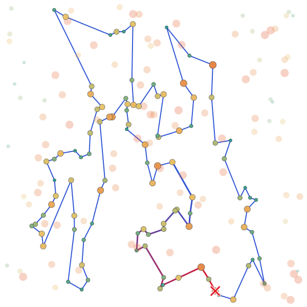
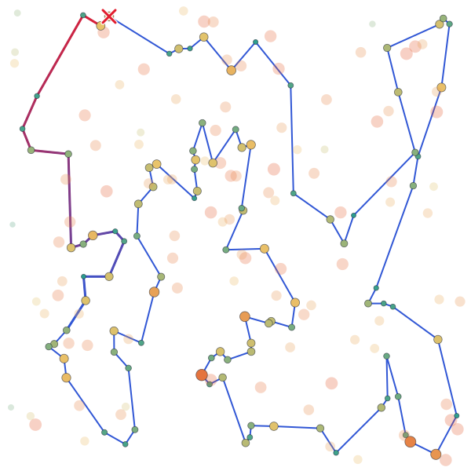
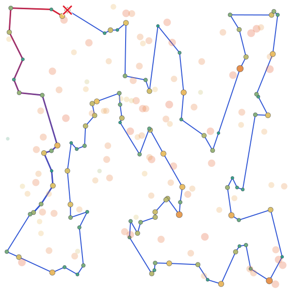
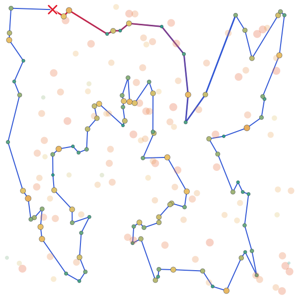
<!-- /auto:results -->

## Running time

<!-- auto:times (generated: edits between these markers are overwritten) -->
Average time of one run **in ms** (algorithm only, same runs as above); the fastest language per row is in bold.

### Instance TSPA

| Method | Python | C | C++ | Rust |
|---|--:|--:|--:|--:|
| Nearest neighbor (any position), 2-regret + best change | 44.34 | **0.68** | 2.86 | 3.14 |
| Greedy cycle, 2-regret + best change | 43.23 | **1.00** | 2.78 | 1.39 |
| Steepest LS, edges exchange, greedy start | 43.54 | 0.89 | **0.87** | 0.95 |
| Steepest LS, edges exchange, list of improving moves, random start | 19.08 | 1.10 | 0.96 | **0.92** |
| MSLS, best of 400 steepest LS with list of moves | 7501.45 | 385.60 | 328.05 | **295.56** |
| ILS, double bridge + 3 node exchanges | 7505.92 | 386.06 | 328.10 | **296.07** |

Runs of basic local search per run (average) in the same runs:

| Method | Python | C | C++ | Rust |
|---|--:|--:|--:|--:|
| MSLS, best of 400 steepest LS with list of moves | 400 | 400 | 400 | 400 |
| ILS, double bridge + 3 node exchanges | 806 | 3043 | 2438 | 2070 |

### Pareto plot (Instance TSPA)

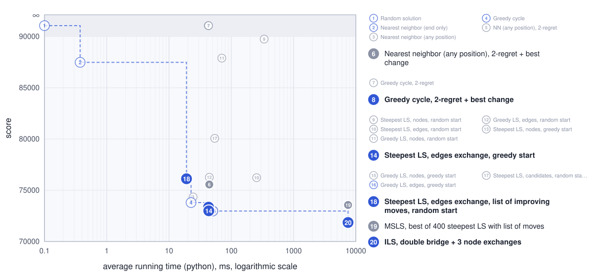

### Instance TSPB

| Method | Python | C | C++ | Rust |
|---|--:|--:|--:|--:|
| Nearest neighbor (any position), 2-regret + best change | 43.22 | **0.70** | 2.91 | 3.14 |
| Greedy cycle, 2-regret + best change | 42.78 | **0.94** | 2.76 | 1.40 |
| Steepest LS, edges exchange, greedy start | 59.17 | 1.12 | **1.04** | 1.16 |
| Steepest LS, edges exchange, list of improving moves, random start | 19.28 | 0.94 | 0.81 | **0.77** |
| MSLS, best of 400 steepest LS with list of moves | 7988.47 | 386.43 | 330.92 | **299.28** |
| ILS, double bridge + 3 node exchanges | 7993.42 | 386.05 | 331.06 | **299.08** |

Runs of basic local search per run (average) in the same runs:

| Method | Python | C | C++ | Rust |
|---|--:|--:|--:|--:|
| MSLS, best of 400 steepest LS with list of moves | 400 | 400 | 400 | 400 |
| ILS, double bridge + 3 node exchanges | 896 | 3360 | 2647 | 2272 |

### Pareto plot (Instance TSPB)

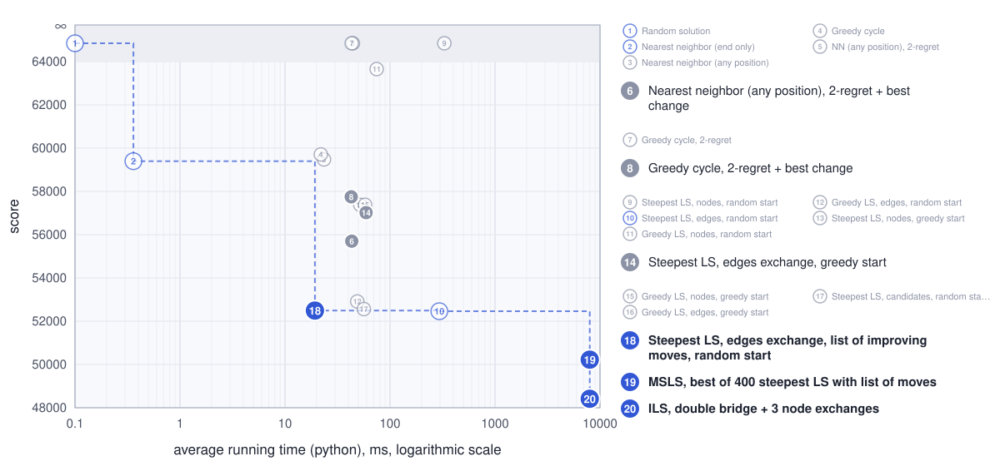
<!-- /auto:times -->

## Best solutions (0-based node indices)

<!-- auto:solutions (generated: edits between these markers are overwritten) -->
### Instance TSPA

**MSLS, best of 400 steepest LS with list of moves**
8, 54, 9, 33, 131, 99, 36, 177, 179, 52, 67, 144, 53, 140, 73, 135, 45, 185, 102, 28, 180, 156, 35, 16, 51, 132, 76, 4, 71, 157, 91, 80, 48, 60, 149, 116, 168, 63, 11, 49, 108, 152, 123, 83, 160, 97, 127, 69, 129, 104, 171, 2, 187, 30, 141, 87, 98, 25, 114, 181, 192, 158, 58, 84, 134, 72, 176, 150, 106, 43, 113, 89, 42, 151, 57, 64, 88, 78, 193, 153, 107, 170, 146, 159, 130, 47, 93, 50, 3, 169, 1, 101, 29, 178, 184, 136, 164, 142, 85, 174

**ILS, double bridge + 3 node exchanges**
97, 160, 83, 123, 100, 152, 108, 49, 168, 63, 149, 116, 60, 31, 48, 80, 91, 157, 71, 4, 76, 132, 180, 28, 102, 185, 35, 156, 51, 16, 67, 144, 140, 53, 179, 52, 177, 36, 131, 33, 9, 54, 8, 85, 93, 50, 3, 169, 1, 164, 186, 136, 184, 178, 29, 101, 147, 47, 130, 159, 146, 170, 153, 193, 78, 88, 107, 64, 57, 182, 151, 42, 89, 113, 106, 150, 174, 176, 72, 134, 84, 58, 158, 192, 181, 114, 135, 73, 45, 87, 141, 30, 187, 189, 2, 171, 104, 129, 69, 127

### Instance TSPB

**MSLS, best of 400 steepest LS with list of moves**
42, 147, 116, 37, 146, 149, 28, 145, 158, 26, 125, 177, 170, 115, 6, 29, 132, 1, 174, 62, 175, 134, 45, 60, 40, 71, 155, 97, 154, 140, 47, 38, 21, 30, 183, 133, 172, 160, 69, 151, 184, 3, 27, 66, 67, 31, 24, 34, 152, 181, 167, 51, 59, 85, 82, 87, 179, 88, 99, 171, 17, 74, 20, 14, 2, 93, 110, 118, 153, 182, 80, 127, 129, 90, 10, 148, 114, 196, 61, 105, 94, 81, 190, 70, 187, 18, 54, 192, 162, 76, 185, 57, 89, 46, 72, 120, 48, 96, 198, 121

**ILS, double bridge + 3 node exchanges**
116, 147, 42, 121, 198, 96, 48, 89, 57, 185, 76, 104, 190, 70, 187, 81, 94, 105, 61, 196, 114, 10, 78, 54, 162, 192, 80, 127, 129, 90, 153, 14, 2, 20, 74, 17, 171, 99, 88, 179, 87, 82, 51, 85, 59, 73, 167, 181, 152, 34, 24, 67, 66, 27, 151, 3, 184, 46, 72, 117, 8, 120, 133, 136, 172, 160, 69, 183, 30, 21, 38, 47, 140, 154, 26, 125, 170, 115, 155, 71, 40, 60, 157, 45, 134, 175, 36, 197, 6, 29, 132, 103, 178, 65, 145, 28, 149, 13, 146, 37
<!-- /auto:solutions -->

## Source code

<!-- auto:source (generated: edits between these markers are overwritten) -->
[labs/lab6](https://github.com/mi-zuri/ec-labs/tree/main/labs/lab6) ([Python](https://github.com/mi-zuri/ec-labs/blob/main/labs/lab6/python/solver.py), [C](https://github.com/mi-zuri/ec-labs/blob/main/labs/lab6/c/solver.c), [C++](https://github.com/mi-zuri/ec-labs/blob/main/labs/lab6/cpp/solver.cpp), [Rust](https://github.com/mi-zuri/ec-labs/blob/main/labs/lab6/rust/solver.rs))
<!-- /auto:source -->

## Conclusions

- **ILS beats MSLS in every run**: its worst run (72 255 on TSPA, 48 974 on TSPB) is better than the best of MSLS (72 909, 49 838), on average by 2.3% and 3.6%, because it keeps improving one good tour instead of starting again.
- **ILS is the best method so far**: 71 854 vs 72 997 (steepest LS from the greedy start) on TSPA and 48 414 vs 52 493 (one local search with LM) on TSPB, while MSLS improves on one local search but still loses to the greedy start on TSPA (73 560).
- **Both cost about 400 local searches** (7.5–8.0 s in Python, 0.30–0.39 s in C, C++ and Rust), in which ILS runs 2–2.2× (Python) to 5–8.4× (C, C++, Rust) more local searches than MSLS.
